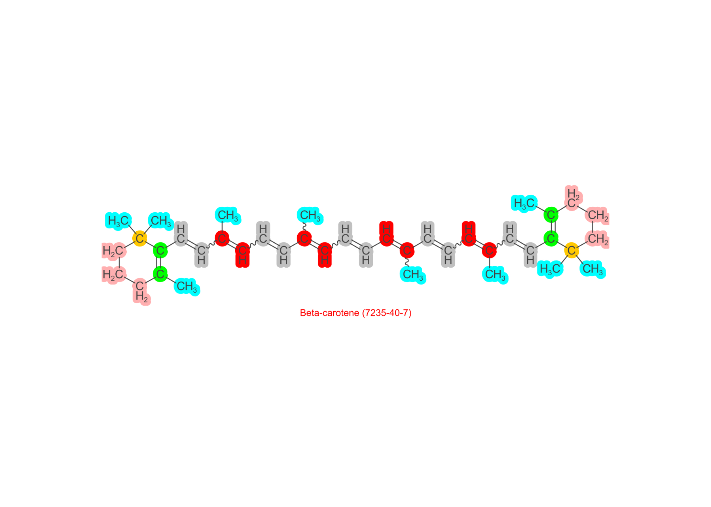
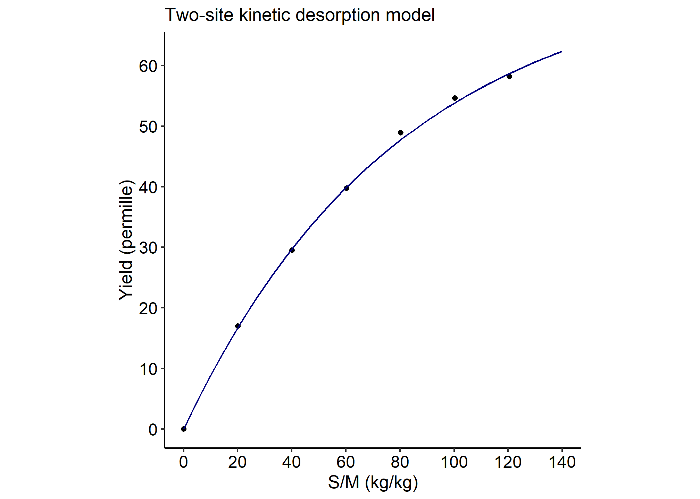
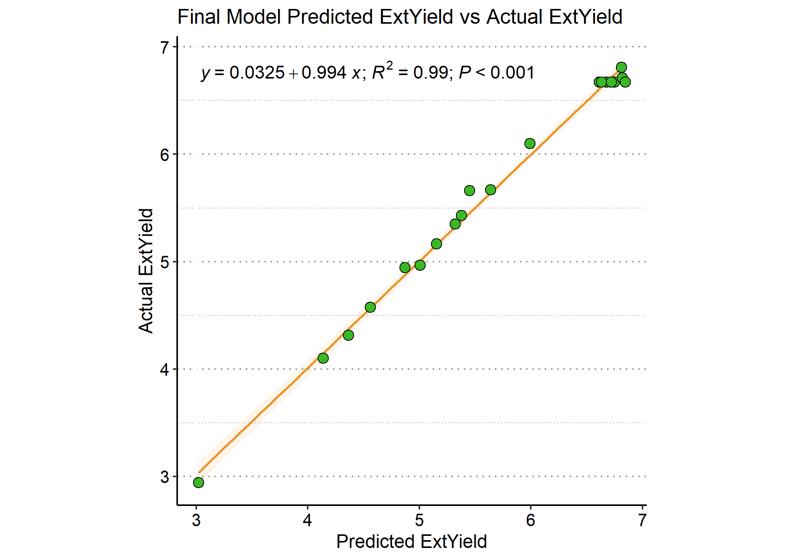

<!-- Useful knitr chunk options -->

<!-- include = FALSE prevents code and results from showing (still runs code) -->

<!-- echo = FALSE prevents code from appearing, but not the results (e.g. figures) -->

<!-- message = FALSE prevents messages that are generated by code from appearing -->

<!-- fig.cap = "" adds caption to graphical results (e.g. ggplot) -->

<!-- eval = FALSE prevents code in chunk from running -->

<!-- ALL OPTIONS: https://www.rstudio.com/wp-content/uploads/2015/03/rmarkdown-reference.pdf -->

<!-- README.md is generated from README.Rmd. Please edit that file -->

# supeRcrit

<!-- badges: start -->

<!-- badges: end -->

## Overview

The package title `supeRcrit` is an abbreviation of “supeRcritical” in
reference to supercritical fluids. The package is designed as a tool for
design, modeling, and optimization of supercritical CO<sub>2</sub> and
(to a lesser extent) subcritical water extraction processes. The package
includes functions for:

1.  Kinetic modeling of such processes using
    [Sovova’s](https://www.doi.org/10.1016/j.supflu.2017.02.014) Broken
    and Intact Cells (BIC) and the two-site [kinetic
    desorption](https://www.doi.org/10.1016/S0021-9673(02)01329-8)
    models (**this is a Work-In-Progress**). See help documentation for
    `?bicmod` and `?ktsmod`. Various supporting functions facilitate
    calculation of CO<sub>2</sub>, ethanol (EtOH), and water densities
    at sub- and supercritical conditions (see `?bendens`, `?etoh_dens`,
    and `?h2o_dens`).

2.  Retrieval of various molecular descriptors and MOL files for target
    compounds from public online databases. See help documentation for
    `?mol_find`.

3.  Predicting the effect of various co-solvents (as supercritical
    CO<sub>2</sub> polarity modifiers) on the solubility of a target
    compound(s), either with the [Hansen Solubility Parameters
    (HSP)](https://www.doi.org/10.1016/j.jfoodeng.2025.112538)
    (`?sfe_mod`) or with a native-R machine-learning model that predicts
    the **absolute** supercritical-CO<sub>2</sub> solubility and
    co-solvent enhancement directly from a SMILES string
    (`?predict_solubility`, `?solub_optim`). Predicted solubilities
    additionally drive an ideal **separator-cascade fractionation**
    simulator (`?chrastil_cascade`, `?solub_cascade`).

4.  Estimating the boiling point, critical temperature, critical
    pressure, and Hansen Solubility Parameters using various methods
    including the
    [Joback](https://www.doi.org/10.1080/00986448708960487), [Stein &
    Brown](https://www.doi.org/10.1021/ci00019a016),
    [Nannoolal](https://www.doi.org/10.1016/j.fluid.2006.11.014),
    [Stefanis &
    Panayiotou](https://www.doi.org/10.1016/j.ijpharm.2012.01.001) and
    other approaches. See help documentation for `?est_gcm`. The melting
    point and enthalpy of vaporization can also be estimated from a
    SMILES string alone via the machine-learned `?gcm_mp` and
    `?gcm_hvap`.

5.  Generating [Design of Experiments
    (DoE)](https://www.doi.org/10.18434/M32189) for both screening or
    process optimization. For an example, see help documentation for
    `?doe_ccd`.

6.  Optimizing SFE and SWE processes using [Response Surface Methodology
    (RSM)](https://www.doi.org/10.1007/s11947-016-1855-2) for one or
    multiple response variables. See help documentation for
    `?doe_analyze` and `?doe_desir`.

7.  Calculating the \[Cost of Manufacturing (COM)\] for optimized SFE
    and SWE processes to maximize profit margin and finalize process
    extraction time. See help documentation for `?calcom`.

8.  Rigorous modeling of supercritical-CO<sub>2</sub> **phase equilibria
    and counter-current fractionation** with the group-contribution
    equation of state
    [GC-EOS](https://www.doi.org/10.1016/0378-3812(88)80059-0) and its
    association-enabled superset
    [GCA-EOS](https://www.doi.org/10.1016/S0378-3812(96)03093-8). This
    covers multicomponent vapour-liquid (and liquid-liquid) flash, phase
    envelopes and mixture critical points, and full equilibrium-stage
    **fractionation-column** simulation with external reflux — for
    processes such as essential-oil deterpenation, squalene
    purification, and free-fatty-acid deacidification. See
    `?gceos_flash`, `?gceos_pxy`, `?gceos_critical`, and
    `?gceos_column_ns_solve`.

9.  Screening solvents for **liquid–liquid extraction** of a target
    solute from a feed phase, ranked by distribution coefficient,
    capacity and selectivity. Activity coefficients come from a native,
    bit-exact
    [COSMO-SAC-dsp](https://www.doi.org/10.1021/acs.jctc.0c00077) engine
    using σ-profiles from a curated 2,259-compound database or the
    53,088-compound [CHAOS](https://www.doi.org/10.5281/zenodo.17691924)
    database; **any other molecule** is handled by the built-in
    **FastSigma** predictor, which estimates a COSMO-SAC σ-profile
    directly from a SMILES string. See `?csac_lle`, `?csac_gamma`,
    `?fastsigma_profile`, and `?plot_sigma_profile`.

## Installation

Use the following command to install `supeRcrit` from
[GitHub](https://www.github.com/Deniz-Koseoglu/supeRcrit):

``` r
install.packages(devtools)
devtools::install_github("Deniz-Koseoglu/supeRcrit", build_vignettes = TRUE)
```

The package may then be loaded via:

``` r
library(supeRcrit)
#> Registered S3 methods overwritten by 'ggpp':
#>   method                  from   
#>   heightDetails.titleGrob ggplot2
#>   widthDetails.titleGrob  ggplot2
```

The package documentation can be accessed with:

``` r
?supeRcrit # documentation
```

## Launching the interactive app

`supeRcrit` ships with an interactive Shiny dashboard that bundles the
package’s modules into a single interface: **Cost Analysis**;
**Solubility & Fractionation** (Solute Characterization, Co-Solvent
Selection/Comparison, Liquid-Liquid Extraction); **Process Simulation**
(GC/GCA-EOS components & phase behaviour); **Design of Experiments**
(design, analysis, desirability); and **Kinetic Modeling**. The
co-solvent modules offer both the Hansen-Solubility and the
machine-learned solubility workflows side by side. Launch it with:

``` r
library(supeRcrit)
run_app()
```

`run_app()` opens the full dashboard; switch between modules using the
sidebar. You can also choose the starting module and pass any argument
on to `shiny::runApp()` (for example a fixed port):

``` r
run_app("doe_analysis")            # start on the DoE Analysis module
run_app("com_analysis", port = 3838)
```

The interface is available in **English, Russian, and Turkish** — pick
the language from the selector in the top-right corner of the dashboard.

## Main functions

The main workflow of `supeRcrit` is supported by the following key and
supporting functions (supporting functions tagged as **incorporated**
are those which are mandatory for completion of the main workflow):

1.  `bicmod` and `ktsmod` - kinetic modeling of SFE and SWE extraction
    processes using **Sovova’s BIC model** and the **two-site kinetic
    desorption model**, respectively. Supporting functions:
    - `bendens` calculates supercritical CO<sub>2</sub> density using
      the [Bender Equation of
      State](https://www.doi.org/10.3303/CET1974120)
    - `etoh_dens` calculates ethanol density at specific temperatures
    - `bic_sm`, `bic_ct`, and `bic_cmp` (**incorporated**) build a
      simplified, “characteristic times”, and complete BIC models
    - `kin_plot` (**incorporated**) plots the model results
    - `kin_splot` visually summarizes the results of multiple kinetic
      models
    - `kin_export` summarizes and exports data in **.CSV** format
      <br/><br/>
2.  `sfe_mod` estimates the ***relative solubility improvement*** of a
    target compound in supercritical CO<sub>2</sub> when one or more
    co-solvents are used at a specific volume fraction(s) as polarity
    modifiers. Supporting functions:
    - `mol_find` retrieves molecular descriptors and a MOL file for a
      molecule given a \[SMILES\]\[link1\] string, CAS number, and/or
      compound name (IUPAC or colloquial).
    - `est_gcm` estimates boiling point, critical parameters
      (temperature, volume, pressure), and/or HSPs via **Group
      Contribution Methods (GCMs)**.
    - `plot_gcm` (**incorporated**) visualizes a molecule from its MOL
      file and optionally highlights sub-structures
    - `hsp_optim` (**incorporated**) calculates the **relative
      solubility improvement (%)** of a target compound in supercritical
      CO<sub>2</sub> using a specific volume fraction of various
      co-solvents. The “best” co-solvent resulting in the highest
      solubility improvement may be determined at one or more
      combinations of pressure and temperature within **75-1000 bar**
      and **31-200 degrees Celsius**, respectively.
    - `show_solv` displays reference HSP parameters and other data used
      by the workflow for various solvents.
    - `gcm_mp` and `gcm_hvap` estimate the **melting point** and
      **enthalpy of vaporization** of a compound from its SMILES string
      using native-R machine-learning models; `abraham_params` returns
      the five Abraham LSER solute descriptors.
    - `predict_solubility` predicts the **absolute**
      supercritical-CO<sub>2</sub> solubility (solute mole fraction) of
      a compound over a temperature/pressure grid, with or without a
      liquid co-solvent, from SMILES alone. `solub_gkg` converts mole
      fraction to a g-of-solute-per-kg-of-CO<sub>2</sub> loading.
    - `solub_optim` ranks candidate co-solvents for a single solute by
      the **predicted solubility enhancement** they provide (the
      machine-learning counterpart of `hsp_optim`).
    - `chrastil_solubility`/`chrastil_db` provide the
      [Chrastil](https://www.doi.org/10.1021/j150612a012) density-based
      solubility correlation and a bundled database of fitted
      coefficients; `chrastil_cascade` and the model-agnostic
      `solub_cascade` simulate an **ideal depressurisation separator
      cascade** for fractionating a mixture of solutes. <br/><br/>
3.  `doe_analyze` systematically creates, analyzes, and (where
    appropriate) simplifies Design of Experiments models, including
    linear models using for screening experiments, as well as the more
    complex quadratic models used by **Response Surface Methodology
    (RSM)** for optimization of one or more responses. Supporting
    functions include:
    - `doe_ffd`, `doe_frfd`, `doe_ccd`, `doe_bbd`, and `doe_tm` generate
      **Designs of Experiments (DoE)** of various types including the
      Full Factorial, Fractional Factorial, Central Composite,
      Box-Behnken, and Taguchi designs for 2-5 factors.
    - `doe_export` and `doeopt_export` compile data from DoE generation
      and analysis, respectively, and export them as an informative
      **.TAB** file.
    - `doex` include some example data to work with.
    - Multiple other incorporated functions provide additional
      functionality but are not intended for standalone use. <br/><br/>
4.  `calcom` calculates the **Cost of Manufacturing (COM)** for SFE and
    SWE processes, including the labor, utilities, raw materials, waste
    management, and fixed costs. Payback period for a given investment
    at any point throughout the extraction process is also calculated,
    facilitating the choice of time that would maximize the profit
    margin. Supporting function include:
    - `show_pars` is a helper function explaining the **input and output
      terms** of the workflow
    - `com_export` compiles and exports all workflow output as a
      **.CSV** file. <br/><br/>
5.  `gceos_column_ns_solve` simulates a counter-current
    supercritical-CO<sub>2</sub> **fractionation column** with the
    GC-EOS / GCA-EOS group-contribution equation of state, reproducing
    literature deterpenation columns to within a fraction of a percent.
    Supporting functions:
    - `gceos_decompose` fragments a molecule (from SMILES) into GC-EOS /
      GCA-EOS groups, and `gceos_params` returns the bundled parameter
      sets (Fornari, association, and the validated Diaz deterpenation
      set).
    - `gceos_fit_dc` regresses the pure-component energy parameter from
      a known saturation point, and `gceos_psat` returns the
      pure-component saturation pressure.
    - `gceos_flash` performs a multicomponent **vapour-liquid (and
      liquid-liquid) flash**; `gceos_saturation`, `gceos_pxy`,
      `gceos_critical`, and `gceos_critical_locus` trace bubble/dew
      points, P-x envelopes, and mixture **critical points/loci**.
    - `gceos_column` (sum-rates) and `gceos_column_ns_solve` (robust
      Naphtali-Sandholm) run the **equilibrium-stage column** with
      external reflux and optional thermal gradients;
      `gceos_column_sizing` and `gceos_column_optimize` add hydraulic
      sizing and operating-window optimisation. With the `"gcaeos"`
      model the optional association term enables **free-fatty-acid,
      water, and alcohol** systems. <br/><br/>
6.  `csac_lle` ranks candidate solvents for **liquid–liquid extraction**
    of a target solute from a feed phase by distribution coefficient
    (`D`), capacity, and selectivity, using a native, bit-exact
    **COSMO-SAC-dsp** activity-coefficient engine. Supporting functions:
    - `csac_gamma` returns the infinite-dilution activity coefficient γ∞
      of a solute in a solvent; `csac_compounds` lists the compounds
      available in either the curated 2,259-compound (`"ud"`) database
      or the 53,088-compound `"chaos"` database.
    - `fastsigma_profile` estimates a COSMO-SAC σ-profile **directly
      from a SMILES string** (a machine-learning model trained on the
      CHAOS database), so any molecule can be screened even when it is
      absent from the databases; `csac_gamma`/`csac_lle` fall back to it
      automatically.
    - `plot_sigma_profile` draws the σ-profile in the standard COSMO-SAC
      style, optionally overlaying the FastSigma estimate on a database
      profile to visualise the model’s accuracy.

For **detailed examples** of all workflows outlined herein, please
consult package vignettes.

## Examples

### Co-Solvent Choice

This module uses the Hansen Solubility Parameters (HSPs) estimated by
Group Contribution Methods (see above), and adjusted based on molar
volume variation with temperature and pressure, to estimate an **HSP
Distance** ****R<sub>a</sub>**** between a target compound and a
CO<sub>2</sub>-co-solvent mixture to be used for extraction. The
workflow begins with retrieval of molecular descriptors from
[SMILES](https://www.daylight.com/dayhtml/doc/theory/theory.smiles.html),
[CAS](https://www.cas.org/about/cas-history), and/or
common/[UIPAC](https://iupac.qmul.ac.uk/class/intro.html) name of any
chosen target compound. While this is carried out automatically as part
of `sfe_mod`, it can also be done separately with `mol_find`:

``` r
#Define beta-carotene as an example
mol <- c("CC1=C(C(CCC1)(C)C)C=CC(=CC=CC(=CC=CC=C(C)C=CC=C(C)C=CC2=C(CCCC2(C)C)C)C)C",
"7235-40-7", "Beta-carotene")

#Retrieve and view molecular descriptors
mol_desc <- mol_find(mol)
mol_desc$IDs[!names(mol_desc$IDs) %in% "InChI"]
#>                                                                      SMILES 
#> "CC1=C(C(CCC1)(C)C)C=CC(=CC=CC(=CC=CC=C(C)C=CC=C(C)C=CC2=C(CCCC2(C)C)C)C)C" 
#>                                                                         CAS 
#>                                                                 "7235-40-7" 
#>                                                                        Name 
#>                                                             "Beta-carotene" 
#>                                                                    InChIKey 
#>                                               "OENHQHLEOONYIE-UHFFFAOYSA-N" 
#>                                                                  Atom_Count 
#>                                                                        "96" 
#>                                                                     H_Count 
#>                                                                        "56" 
#>                                                                          MW 
#>                                                             "536.438201792" 
#>                                                                          MF 
#>                                                                    "C40H56" 
#>                                                                 Aromaticity 
#>                                                                     "FALSE"
```

The function `sfe_mod` may then be used to estimate critical
temperature, boiling point, HSP parameters, and calculate distance
****R<sub>a</sub>**** with the associated **Miscibility Enhancement
(%)** provided by various co-solvent versus pure CO<sub>2</sub>. In the
following example, we compare the co-solvent performance of hexane,
methanol, and methyl oleate at a volume fraction of 10% that of
CO<sub>2</sub>:

``` r
#Compare co-solvent performance of 10% hexane, ethanol, and methyl oleate for dissolving beta-carotene
optres <- sfe_mod(solute = mol,
                  modif = c("Hexane", "Ethanol", "MethylOleate"),
                  vfrac = 0.1,
                  tb = "SB_corr",
                  crit = "NL07_robust",
                  hsp = "SP12")
#> 
#> Retrieving compound data...
#> Calculating/retrieving boiling point ...
#> Calculating/retrieving critical temperature and other parameters ...
#> Calculating/retrieving Hansen Solubility Parameters (HSP) ...
#> Rounding SFE temperature and pressure constraints to whole numbers...
#> Calculating SFE miscibility enhancement using a 0.1 volume fraction of the following modifiers: 'Hexane', 'Ethanol', 'MethylOleate'.
#> Calculating temperature influence of HSP values of solute...
#> Processing molar volumes...
#> Calculating the temperature and pressure influence on HSP of solvent(s)...
#> Calculating Ra distances and Miscibility Enhancement (%)...
#> DONE!

#View miscibility enhancement for hexane (for example) at various temperatures and pressures
optres$sfe$Miscib_Enhancement$`CO2 with Hexane`
#>           32       35       38       41       44       47       50       53
#> 80  15.27780 13.16468 12.71005 12.59783 12.53268 12.48482 12.44688 12.41399
#> 100 17.72239 16.65615 15.66940 14.73927 13.91250 13.33122 13.02159 12.85003
#> 120 19.69878 18.58126 17.58215 16.69479 15.90012 15.19361 14.58009 14.07322
#> 140 21.66401 20.43148 19.35162 18.38583 17.53074 16.76764 16.09756 15.50492
#> 160 23.71113 22.35336 21.15509 20.08278 19.13601 18.28715 17.53856 16.87461
#> 180 25.86717 24.37417 23.04926 21.85775 20.79264 19.84755 19.00759 18.26319
#> 200 28.06468 26.48201 25.03537 23.73347 22.55035 21.50199 20.55802 19.71290
#> 220 30.25596 28.64252 27.12436 25.70706 24.42699 23.24883 22.20252 21.25899
#> 240 32.30115 30.78425 29.23560 27.76499 26.38411 25.11986 23.96328 22.91167
#> 260 33.99815 32.72236 31.30853 29.83455 28.42198 27.05534 25.81514 24.66606
#> 280 35.06791 34.28571 33.15185 31.83217 30.43609 29.04700 27.74924 26.51276
#> 300 35.26520 35.19400 34.56547 33.54417 32.34391 31.03620 29.71027 28.44214
#> 320 34.39296 35.21357 35.29626 34.81269 33.93383 32.83893 31.61255 30.36192
#> 340 32.39214 34.18440 35.11454 35.36198 35.02933 34.29203 33.31174 32.17766
#> 360 29.52582 32.08203 33.90215 34.99286 35.38001 35.21254 34.62908 33.76268
#> 380 26.11938 29.20387 31.68468 33.58619 34.81125 35.34497 35.34298 34.91051
#> 400 22.46130 25.76091 28.69207 31.26087 33.23023 34.55061 35.24871 35.42047
#>           56       59       62       65       68       70
#> 80  12.38541 12.35783 12.33282 12.30880 12.28653 12.27117
#> 100 12.74153 12.66367 12.60415 12.55502 12.51260 12.48765
#> 120 13.67926 13.39250 13.18695 13.03837 12.92611 12.86523
#> 140 14.99252 14.55305 14.18587 13.88690 13.64760 13.51516
#> 160 16.28714 15.76684 15.31470 14.92379 14.58536 14.38571
#> 180 17.59760 17.00156 16.48104 16.01407 15.60287 15.35833
#> 200 18.96088 18.29307 17.69134 17.15864 16.67975 16.39010
#> 220 20.41767 19.66017 18.97796 18.36920 17.81974 17.48929
#> 240 21.96715 21.11387 20.35421 19.66177 19.03856 18.65867
#> 260 23.61834 22.68025 21.82158 21.04937 20.34784 19.91898
#> 280 25.37817 24.34138 23.39731 22.53880 21.75420 21.27508
#> 300 27.23878 26.11106 25.07221 24.13596 23.26550 22.73553
#> 320 29.13533 27.95110 26.84918 25.81329 24.87430 24.29094
#> 340 31.00660 29.81676 28.68388 27.59868 26.58160 25.94663
#> 360 32.72547 31.62837 30.50317 29.39679 28.33462 27.67312
#> 380 34.17804 33.25551 32.23757 31.19510 30.11925 29.43841
#> 400 35.15141 34.55635 33.76645 32.82643 31.84947 31.17801

#View best co-solvent at various temperatures and pressures
optres$sfe$Best_Modifier
#>     32     35     38     41     44     47     50     53     56     59    
#> 80  "MeOl" "MeOl" "MeOl" "MeOl" "MeOl" "MeOl" "MeOl" "MeOl" "MeOl" "MeOl"
#> 100 "MeOl" "MeOl" "MeOl" "MeOl" "MeOl" "MeOl" "MeOl" "MeOl" "MeOl" "MeOl"
#> 120 "MeOl" "MeOl" "MeOl" "MeOl" "MeOl" "MeOl" "MeOl" "MeOl" "MeOl" "MeOl"
#> 140 "MeOl" "MeOl" "MeOl" "MeOl" "MeOl" "MeOl" "MeOl" "MeOl" "MeOl" "MeOl"
#> 160 "Hex"  "MeOl" "MeOl" "MeOl" "MeOl" "MeOl" "MeOl" "MeOl" "MeOl" "MeOl"
#> 180 "Hex"  "Hex"  "MeOl" "MeOl" "MeOl" "MeOl" "MeOl" "MeOl" "MeOl" "MeOl"
#> 200 "Hex"  "Hex"  "Hex"  "Hex"  "MeOl" "MeOl" "MeOl" "MeOl" "MeOl" "MeOl"
#> 220 "Hex"  "Hex"  "Hex"  "Hex"  "Hex"  "MeOl" "MeOl" "MeOl" "MeOl" "MeOl"
#> 240 "Hex"  "Hex"  "Hex"  "Hex"  "Hex"  "Hex"  "Hex"  "MeOl" "MeOl" "MeOl"
#> 260 "Hex"  "Hex"  "Hex"  "Hex"  "Hex"  "Hex"  "Hex"  "Hex"  "Hex"  "MeOl"
#> 280 "Hex"  "Hex"  "Hex"  "Hex"  "Hex"  "Hex"  "Hex"  "Hex"  "Hex"  "Hex" 
#> 300 "Hex"  "Hex"  "Hex"  "Hex"  "Hex"  "Hex"  "Hex"  "Hex"  "Hex"  "Hex" 
#> 320 "Hex"  "Hex"  "Hex"  "Hex"  "Hex"  "Hex"  "Hex"  "Hex"  "Hex"  "Hex" 
#> 340 "Hex"  "Hex"  "Hex"  "Hex"  "Hex"  "Hex"  "Hex"  "Hex"  "Hex"  "Hex" 
#> 360 "Hex"  "Hex"  "Hex"  "Hex"  "Hex"  "Hex"  "Hex"  "Hex"  "Hex"  "Hex" 
#> 380 "Hex"  "Hex"  "Hex"  "Hex"  "Hex"  "Hex"  "Hex"  "Hex"  "Hex"  "Hex" 
#> 400 "Hex"  "Hex"  "Hex"  "Hex"  "Hex"  "Hex"  "Hex"  "Hex"  "Hex"  "Hex" 
#>     62     65     68     70    
#> 80  "MeOl" "MeOl" "MeOl" "MeOl"
#> 100 "MeOl" "MeOl" "MeOl" "MeOl"
#> 120 "MeOl" "MeOl" "MeOl" "MeOl"
#> 140 "MeOl" "MeOl" "MeOl" "MeOl"
#> 160 "MeOl" "MeOl" "MeOl" "MeOl"
#> 180 "MeOl" "MeOl" "MeOl" "MeOl"
#> 200 "MeOl" "MeOl" "MeOl" "MeOl"
#> 220 "MeOl" "MeOl" "MeOl" "MeOl"
#> 240 "MeOl" "MeOl" "MeOl" "MeOl"
#> 260 "MeOl" "MeOl" "MeOl" "MeOl"
#> 280 "MeOl" "MeOl" "MeOl" "MeOl"
#> 300 "Hex"  "Hex"  "MeOl" "MeOl"
#> 320 "Hex"  "Hex"  "Hex"  "Hex" 
#> 340 "Hex"  "Hex"  "Hex"  "Hex" 
#> 360 "Hex"  "Hex"  "Hex"  "Hex" 
#> 380 "Hex"  "Hex"  "Hex"  "Hex" 
#> 400 "Hex"  "Hex"  "Hex"  "Hex"

#View co-solvent ranking based on the number of temperature-pressure couplings where it results in the highest miscibility
optres$sfe$Modifier_Ranking
#> 
#>      Hex     MeOl 
#> 50.42017 49.57983

#View estimated critical parameters
optres$parameters$Critical
#>         Tb         Tc         Pc         Vc 
#>  856.30727 1102.97908   10.36671 1279.09999

#View estimated HSPs
optres$parameters$HSP
#>       dD       dP      dHB 
#> 12.86394  3.62530  5.70970

#View detected functional groups and their contribution to the GCM estimation methods
optres$parameters$Contribs
#> $Tb
#>     Group ID    SMARTS Tb_cont                       smarts Type pr id   name
#> 1    -CH3  1 Available   21.98                  [CX4;H3,H4]    1 NA  1   -CH3
#> 3   >CrH2  3 Available   26.44                   [CX4;H2;R]    1 NA  3  >CrH2
#> 7    >Cr<  7 Available   11.12                   [CX4;H0;R]    1 NA  7   >Cr<
#> 9  :::CH-  9 Available   27.95 [CX3;H1;R0;$([CX3;H1]=[#6])]    1 NA  9 :::CH-
#> 11  :::C< 11 Available   23.58 [CX3;H0;R0;$([CX3;H0]=[#6])]    1 NA 11  :::C<
#> 12 :::Cr< 12 Available   28.19  [CX3;H0;R;$([CX3;H0]=[#6])]    1 NA 12 :::Cr<
#>    Occurrences Sum_Tb_cont
#> 1           10      219.80
#> 3            6      158.64
#> 7            2       22.24
#> 9           14      391.30
#> 11           4       94.32
#> 12           4      112.76
#> 
#> $Critical
#>               Group Group_ID Type
#> 1          CH3-(ne)        1    1
#> 9          -C(r)H2-        9    1
#> 11           >C(r)<       11    1
#> 58    >C(c):::C(c)<       58    1
#> 62    >C(r):::C(r)<       62    1
#> 89 >C:::C-C:::C<(c)       89    1
#>                                           Description    SMARTS ID  Tb_cont
#> 1         CH3- not connected to either N, O, F, or Cl Available  1 177.3066
#> 9                                    =-CH2- in a ring Available  9 239.4957
#> 11                                      >C< in a ring Available 11 209.9749
#> 58 >C:::C< (both C have at least one non-H neighbour) Available 58 475.7958
#> 62                                     Cyclic >C:::C< Available 62 475.9623
#> 89                  Conjugated double bond in a chain Available 89 928.9954
#>       Tc_cont     Pc_cont Vc_cont  PR
#> 1   0.0418682  0.00081620 28.7855 105
#> 9   0.0212898  0.00034027 24.8517 113
#> 11 -0.0170459 -0.00051299  5.9550 120
#> 58  0.0451531  0.00071581      NA  62
#> 62  0.0564059  0.00034731 34.1240  60
#> 89         NA          NA      NA   7
#>                                                                            smarts
#> 1                                        [CH3;!$([CH3][#7,#8,#9,#17]);!$([CH3]c)]
#> 9                                                                      [CX4;H2;R]
#> 11                                           [CX4;H0;R;!$(C-[#7,#8,#17]);!$(C-c)]
#> 58 [CX3;H0,H1;!$(C=Cc);!$(C=C[!#6;!#1])]=;!@[CX3;H0,H1;!$(C=Cc);!$(C=C[!#6;!#1])]
#> 62                                                                [CX3;R]=[CX3;R]
#> 89                                            [CX3;R0]=[CX3;R0]-[CX3;R0]=[CX3;R0]
#>     pr id             name Occurrences Sum_Tb_cont Sum_Tc_cont Sum_Pc_cont
#> 1  105  1         CH3-(ne)          10   1773.0660   0.4186820  0.00816200
#> 9  113  9         -C(r)H2-           6   1436.9742   0.1277388  0.00204162
#> 11 120 11           >C(r)<           2    419.9498  -0.0340918 -0.00102598
#> 58  62 58    >C(c):::C(c)<           1    475.7958   0.0451531  0.00071581
#> 62  60 62    >C(r):::C(r)<           2    951.9246   0.1128118  0.00069462
#> 89   7 89 >C:::C-C:::C<(c)           4   3715.9816          NA          NA
#>    Sum_Vc_cont
#> 1     287.8550
#> 9     149.1102
#> 11     11.9100
#> 58          NA
#> 62     68.2480
#> 89          NA
#> 
#> $HSP
#>     ID         Group    SMARTS Type dD_cont dP_cont dHB_cont dP_low_cont
#> 1    1          -CH3 Available    1 -123.01 -1.6444  -0.7458     -0.7107
#> 2    2          -CH2 Available    1    1.82 -0.3141  -0.3877     -0.1361
#> 4    4           >C< Available    1  182.13  2.0249  -0.0113          NA
#> 6    6     -CH:::CH- Available    1   28.65 -0.5037  -0.1253     -0.1503
#> 8    8      -CH:::C< Available    1   62.48 -1.1018  -1.7171      1.2761
#> 9   70       >C:::C< Available    1   50.10  0.9957  -1.9773          NA
#> 82 831       C6-ring Available    2  -26.15 -3.6661       NA     -0.9615
#> 83 832 -C:::C-C:::C- Available    2   -5.69 -3.3100  -1.2207      0.6463
#>    dHB_low_cont                                 smarts pr  id          name
#> 1        0.2990                            [CX4;H3,H4] NA   1          -CH3
#> 2       -0.1161                               [CX4;H2] NA   2          -CH2
#> 4            NA                               [CX4;H0] NA   4           >C<
#> 6        0.4819                      [CX3;H1]=[CX3;H1] NA   6     -CH:::CH-
#> 8       -0.0307                      [CX3;H1]=[CX3;H0] NA   8      -CH:::C<
#> 9       -0.1212                      [CX3;H0]=[CX3;H0] NA  70       >C:::C<
#> 82       0.0000 [Cx2]~1~[Cx2]~[Cx2]~[Cx2]~[Cx2]~[Cx2]1 NA 831       C6-ring
#> 83           NA                [CX3]=[CX3]-[CX3]=[CX3] NA 832 -C:::C-C:::C-
#>    Occurrences Sum_dD_cont Sum_dP_cont Sum_dHB_cont Sum_dP_low_cont
#> 1           10    -1230.10    -16.4440      -7.4580         -7.1070
#> 2            6       10.92     -1.8846      -2.3262         -0.8166
#> 4            2      364.26      4.0498      -0.0226              NA
#> 6            5      143.25     -2.5185      -0.6265         -0.7515
#> 8            4      249.92     -4.4072      -6.8684          5.1044
#> 9            2      100.20      1.9914      -3.9546              NA
#> 82           2      -52.30     -7.3322           NA         -1.9230
#> 83          10      -56.90    -33.1000     -12.2070          6.4630
#>    Sum_dHB_low_cont
#> 1            2.9900
#> 2           -0.6966
#> 4                NA
#> 6            2.4095
#> 8           -0.1228
#> 9           -0.2424
#> 82           0.0000
#> 83               NA

#Plot detected functional groups for HSP GCM (as an example). The visualisation is a
#list of one or more images (one per molecule sub-structure); plot the first here.
grid::grid.raster(optres$gcm_vis$HSP[[1]])
```



The workflow can also predict miscibility enhancement for solvent
**mixtures** with two or more components using the `modif` argument:

``` r
optres_2 <- sfe_mod(solute = mol,
                    modif = list(c("Ethanol", "Water"), "Ethanol", "MethylOleate"),
                    modfracs = list(50),
                    tb = "SB_corr",
                    crit = "NL07_robust",
                    hsp = "SP12")
#> 
#> Retrieving compound data...
#> Calculating/retrieving boiling point ...
#> Calculating/retrieving critical temperature and other parameters ...
#> Calculating/retrieving Hansen Solubility Parameters (HSP) ...
#> Rounding SFE temperature and pressure constraints to whole numbers...
#> Calculating SFE miscibility enhancement using a 0.1 volume fraction of the following modifiers: 'Ethanol:Water (50:50)', 'Ethanol', 'MethylOleate'.
#> Calculating temperature influence of HSP values of solute...
#> Processing molar volumes...
#> Calculating the temperature and pressure influence on HSP of solvent(s)...
#> Calculating Ra distances and Miscibility Enhancement (%)...
#> DONE!

#View the miscibility enhancement of 50:50 Ethanol:Water
optres_2$sfe$Miscib_Enhancement$`CO2 with Ethanol:Water (50:50)`
#>             32          35          38         41          44         47
#> 80    6.594588   8.7121869   8.6448837   8.536590   8.4493946   8.375523
#> 100   2.452415   4.4783204   6.1202483   7.406638   8.2855372   8.677028
#> 120  -1.573474   0.9093687   2.9382426   4.571468   5.8831256   6.908742
#> 140  -6.058676  -3.0067333  -0.5157302   1.545589   3.2320898   4.604699
#> 160 -11.147553  -7.4709878  -4.4227121  -1.879341   0.2224321   1.970064
#> 180 -16.982234 -12.5735484  -8.9202520  -5.831249  -3.2305302  -1.069474
#> 200 -23.487720 -18.3692077 -14.0354123 -10.350685  -7.2256908  -4.592882
#> 220 -30.696355 -24.8847574 -19.8601691 -15.513335 -11.8489042  -8.655514
#> 240 -38.544878 -32.1107372 -26.3554717 -21.381051 -17.0625998 -13.350548
#> 260 -46.802282 -39.8263133 -33.5803079 -27.901341 -23.0009558 -18.608273
#> 280 -55.033472 -47.9253568 -41.2695437 -35.104289 -29.5177362 -24.553778
#> 300 -62.942392 -56.0224445 -49.2045389 -42.615679 -36.6759195 -31.216566
#> 320 -70.068928 -63.7000473 -57.1688346 -50.503034 -44.1236421 -38.304411
#> 340 -75.982149 -70.5258607 -64.6044001 -58.157635 -51.8123150 -45.655461
#> 360 -80.136293 -76.1180614 -71.1128078 -65.340708 -59.2956610 -53.276356
#> 380 -82.507004 -79.9993767 -76.3611841 -71.677642 -66.2090161 -60.570600
#> 400 -83.203336 -82.2339770 -80.0179330 -76.585216 -72.2181772 -67.202486
#>              50          53         56          59         62          65
#> 80    8.3091148   8.2492456   8.194373   8.1418609   8.092578   8.0458556
#> 100   8.7586166   8.7429016   8.698892   8.6484260   8.595648   8.5442136
#> 120   7.6672383   8.1830347   8.498092   8.6622372   8.735073   8.7554333
#> 140   5.7028470   6.5762129   7.250500   7.7574121   8.119385   8.3685548
#> 160   3.4074808   4.5796639   5.537059   6.3115137   6.922495   7.4042303
#> 180   0.7363243   2.2338352   3.485164   4.5228572   5.371503   6.0671212
#> 200  -2.3782985  -0.4990969   1.074316   2.3875906   3.499957   4.4220282
#> 220  -5.9772769  -3.6870890  -1.761629  -0.1167772   1.274929   2.4508693
#> 240 -10.1461638  -7.3924632  -5.047856  -3.0331273  -1.332297   0.1391405
#> 260 -14.8949349 -11.6255920  -8.817989  -6.4410712  -4.353343  -2.5741537
#> 280 -20.2628900 -16.4560806 -13.167009 -10.3258813  -7.852595  -5.7318096
#> 300 -26.2867407 -21.9704317 -18.152127 -14.7997020 -11.877094  -9.3704478
#> 320 -32.8867525 -28.0221721 -23.710955 -19.8470749 -16.477025 -13.4876905
#> 340 -39.9816608 -34.6189590 -29.854552 -25.4858116 -21.674079 -18.2328301
#> 360 -47.3553747 -41.6992843 -36.422352 -31.6787478 -27.360218 -23.4758444
#> 380 -54.7387087 -48.9390577 -43.463561 -38.2835632 -33.579762 -29.3469756
#> 400 -61.8306306 -56.2025905 -50.673496 -45.2642347 -40.329127 -35.5664379
#>             68          70
#> 80    8.001332   7.9712654
#> 100   8.494548   8.4624769
#> 120   8.750907   8.7381427
#> 140   8.529797   8.6040183
#> 160   7.774507   7.9681543
#> 180   6.637376   6.9501822
#> 200   5.192055   5.6358817
#> 220   3.449257   4.0284453
#> 240   1.386455   2.1139571
#> 260  -1.040759  -0.1406516
#> 280  -3.866422  -2.7743875
#> 300  -7.155510  -5.8442031
#> 320 -10.899520  -9.3716197
#> 340 -15.209228 -13.4062855
#> 360 -20.007492 -17.9508600
#> 380 -25.401168 -23.0657298
#> 400 -31.344308 -28.6880859

#View final co-solvent ranking
optres_2$sfe$Modifier_Ranking
#> 
#> MeOl 
#>  100
```

### Kinetic modeling (Work-In-Progress)

Modeling of the extraction curve allows the derivation of various
parameters about the **Overall Extraction Curve (OEC)** of a given SFE
or SWE process. For more detail and examples, consult the ****Kinetic
Modeling**** vignette. Various types of BIC (Sovova) and KTS (two-site
desorption) models may be generated via their respective functions,
`bicmod` and `ktsmod`. As input data, a table of time and a response(s)
is used to model the extraction curve.

``` r
## Load and view example data for kinetic modeling
kin_smp <- swex[["duba1"]][["data"]]
kin_smp
#>   Time_min Yield_80C Yield_100C Yield_120C
#> 1        0      0.00       0.00       0.00
#> 2       20     12.71      17.01      18.56
#> 3       40     21.76      29.53      34.92
#> 4       60     29.12      39.77      46.44
#> 5       80     33.51      48.91      54.49
#> 6      100     36.57      54.58      60.98
#> 7      120     39.18      58.15      66.56
```

This data includes SWE results obtained via SWE of defatted grape seeds
at 80-120 degrees Celsius (100 degrees are used here) and 15 bar and 2
mL/min of water flow. The extractable material fraction `c0` is set to
77 permille (parts per thousand), and the mass of sample is 2 grams. The
fraction of easily-desorbed solute, `f`, is set to 0.24 - while this
parameter is usually estimated by the model, it may be provided
separately where an accurate value was previously determined. Non-linear
optimization `nlopt` is used for convergence, and no initial estimates
of output parameters is given in `opt_est`.

``` r
twosite_res <- ktsmod(oec = swex[["duba1"]][["data"]],
oec_vars = c(x = "Time_min", y = "Yield_100C"),
pars = c(pres = 15, temp = 100, flow = 2, c0 = 77, m_in = 2, f = 0.24),
opt_est = "default",
units = c(flow = "mL/min", resp = "permille"),
plot_units = c(x = "q", y = "abs"),
cumulative = TRUE,
mass_flow = FALSE,
flowpar = rep(NA,2),
ro_h2o = NA,
tmax = NA,
qmax = NA,
optmet = "nlopt",
draw = FALSE)
#> 
#> Setting up input variable and initial parameter estimates...
#> Deriving model...
#> Generating plot...
#> DONE!

#Draw model plot
twosite_res$plots$tws
```



It is also possible to view model data and various input, fit, and
overall model parameters:

``` r
#View input data with appended model predictions
twosite_res$data
#>   Time_min Yield_80C Yield_100C Yield_120C        sm yield_g yield_cc0
#> 1        0      0.00       0.00       0.00   0.00000 0.00000 0.0000000
#> 2       20     12.71      17.01      18.56  20.07352 0.03402 0.2209091
#> 3       40     21.76      29.53      34.92  40.14704 0.05906 0.3835065
#> 4       60     29.12      39.77      46.44  60.22056 0.07954 0.5164935
#> 5       80     33.51      48.91      54.49  80.29408 0.09782 0.6351948
#> 6      100     36.57      54.58      60.98 100.36761 0.10916 0.7088312
#> 7      120     39.18      58.15      66.56 120.44113 0.11630 0.7551948

#View model parameters
twosite_res$tws$mod_pars
#>           c0            f           k1           k2 
#> 77.000000000  0.240000000  0.008032273  0.013639317

#Check which of these parameters were modelled
twosite_res$tws$fit_pars
#> [1] "k1" "k2"

#Check input parameters
twosite_res$input
#>         pres         temp         flow           c0      mass_in            m 
#> 1.500000e+01 1.000000e+02 2.867646e-05 7.700000e+01 2.000000e+00 7.000000e+00
```

### Design of Experiments (DoE) generator

This workflow is able to generate Full Factorial, Fractional Factorial,
Central Composite, Box-Behnken, and Taguchi experimental design matrices
with 2-5 factors and 2-5 levels. Additional options include flexible
aliasing patterns, run order randomization, exporting of results,
addition of center points, factor names etc. Some examples of design
generation are presented below:

    #> 
    #> Note that 3-level FFD designs must contain 3 center points by default! Only ADDITIONAL center points are provided in 'cpts'.
    #> Adding center points...
    #> Calculating uncoded factor levels...
    #> $doe
    #> $doe$FFD_3sup3_ResV
    #>    Standard_Order  A  B  C A_Pressure B_Temperature C_Flow
    #> 17             17  0  1  0        300          70.0      3
    #> 5               5  0  0 -1        300          52.5      2
    #> 1               1 -1 -1 -1        100          35.0      2
    #> 25             25 -1  1  1        100          70.0      4
    #> 10             10 -1 -1  0        100          35.0      3
    #> 4               4 -1  0 -1        100          52.5      2
    #> 18             18  1  1  0        500          70.0      3
    #> 30             30  0  0  0        300          52.5      3
    #> 15             15  1  0  0        500          52.5      3
    #> 7               7 -1  1 -1        100          70.0      2
    #> 27             27  1  1  1        500          70.0      4
    #> 29             29  0  0  0        300          52.5      3
    #> 14             14  0  0  0        300          52.5      3
    #> 22             22 -1  0  1        100          52.5      4
    #> 3               3  1 -1 -1        500          35.0      2
    #> 9               9  1  1 -1        500          70.0      2
    #> 23             23  0  0  1        300          52.5      4
    #> 11             11  0 -1  0        300          35.0      3
    #> 20             20  0 -1  1        300          35.0      4
    #> 19             19 -1 -1  1        100          35.0      4
    #> 13             13 -1  0  0        100          52.5      3
    #> 12             12  1 -1  0        500          35.0      3
    #> 2               2  0 -1 -1        300          35.0      2
    #> 24             24  1  0  1        500          52.5      4
    #> 16             16 -1  1  0        100          70.0      3
    #> 8               8  0  1 -1        300          70.0      2
    #> 28             28  0  0  0        300          52.5      3
    #> 26             26  0  1  1        300          70.0      4
    #> 6               6  1  0 -1        500          52.5      2
    #> 21             21  1 -1  1        500          35.0      4
    #> 
    #> $doe$call
    #> doe_ffd(levels = 3, factors = 3, cpts = 3, fnames = c("Pressure", 
    #>     "Temperature", "Flow"), flims = list(c(100, 500), c(35, 70), 
    #>     c(2, 4)))
    #> 
    #> 
    #> $description
    #> [1] "A 3^3 FFD (FULL FACTORIAL) DESIGN OF RESOLUTION V WITH 30 RUNS AND 3 ADDED CENTER POINTS"
    #> 
    #> Note that 3-level FFD designs must contain 3 center points by default! Only ADDITIONAL center points are provided in 'cpts'.
    #> Adding center points...
    #> Calculating uncoded factor levels...
    #> $doe
    #> $doe$FFD_3sup3_ResV
    #>    Standard_Order  A  B  C A_Pressure B_Temperature C_Flow
    #> 11             11  0 -1  0        300          35.0      3
    #> 15             15  1  0  0        500          52.5      3
    #> 22             22 -1  0  1        100          52.5      4
    #> 26             26  0  1  1        300          70.0      4
    #> 8               8  0  1 -1        300          70.0      2
    #> 4               4 -1  0 -1        100          52.5      2
    #> 25             25 -1  1  1        100          70.0      4
    #> 28             28  0  0  0        300          52.5      3
    #> 18             18  1  1  0        500          70.0      3
    #> 13             13 -1  0  0        100          52.5      3
    #> 5               5  0  0 -1        300          52.5      2
    #> 24             24  1  0  1        500          52.5      4
    #> 2               2  0 -1 -1        300          35.0      2
    #> 3               3  1 -1 -1        500          35.0      2
    #> 27             27  1  1  1        500          70.0      4
    #> 7               7 -1  1 -1        100          70.0      2
    #> 1               1 -1 -1 -1        100          35.0      2
    #> 20             20  0 -1  1        300          35.0      4
    #> 10             10 -1 -1  0        100          35.0      3
    #> 23             23  0  0  1        300          52.5      4
    #> 6               6  1  0 -1        500          52.5      2
    #> 12             12  1 -1  0        500          35.0      3
    #> 30             30  0  0  0        300          52.5      3
    #> 19             19 -1 -1  1        100          35.0      4
    #> 17             17  0  1  0        300          70.0      3
    #> 21             21  1 -1  1        500          35.0      4
    #> 16             16 -1  1  0        100          70.0      3
    #> 9               9  1  1 -1        500          70.0      2
    #> 29             29  0  0  0        300          52.5      3
    #> 14             14  0  0  0        300          52.5      3
    #> 
    #> $doe$call
    #> doe_ffd(levels = 3, factors = 3, cpts = 3, fnames = c("Pressure", 
    #>     "Temperature", "Flow"), flims = list(c(100, 500), c(35, 70), 
    #>     c(2, 4)))
    #> 
    #> 
    #> $description
    #> [1] "A 3^3 FFD (FULL FACTORIAL) DESIGN OF RESOLUTION V WITH 30 RUNS AND 3 ADDED CENTER POINTS"
    #> 
    #> Adding star points...
    #> Adding center points...
    #> Calculating uncoded factor levels...
    #> $doe
    #> $doe$CCC_5sup3_with_6_starpoints_and_6_centerpoints
    #>    Standard_Order         A         B         C A_Pressure B_Temperature
    #> 10             10  1.681793  0.000000  0.000000   345.0000      55.00000
    #> 8               8  1.000000  1.000000  1.000000   295.3389      66.89207
    #> 5               5 -1.000000 -1.000000  1.000000   149.6611      43.10793
    #> 1               1 -1.000000 -1.000000 -1.000000   149.6611      43.10793
    #> 17             17  0.000000  0.000000  0.000000   222.5000      55.00000
    #> 7               7 -1.000000  1.000000  1.000000   149.6611      66.89207
    #> 4               4  1.000000  1.000000 -1.000000   295.3389      66.89207
    #> 13             13  0.000000  0.000000 -1.681793   222.5000      55.00000
    #> 20             20  0.000000  0.000000  0.000000   222.5000      55.00000
    #> 9               9 -1.681793  0.000000  0.000000   100.0000      55.00000
    #> 14             14  0.000000  0.000000  1.681793   222.5000      55.00000
    #> 11             11  0.000000 -1.681793  0.000000   222.5000      35.00000
    #> 3               3 -1.000000  1.000000 -1.000000   149.6611      66.89207
    #> 19             19  0.000000  0.000000  0.000000   222.5000      55.00000
    #> 18             18  0.000000  0.000000  0.000000   222.5000      55.00000
    #> 6               6  1.000000 -1.000000  1.000000   295.3389      43.10793
    #> 12             12  0.000000  1.681793  0.000000   222.5000      75.00000
    #> 2               2  1.000000 -1.000000 -1.000000   295.3389      43.10793
    #> 16             16  0.000000  0.000000  0.000000   222.5000      55.00000
    #> 15             15  0.000000  0.000000  0.000000   222.5000      55.00000
    #>    C_Co-Solvent
    #> 10   5.00000000
    #> 8    8.00000000
    #> 5    8.00000000
    #> 1    2.00000000
    #> 17   5.00000000
    #> 7    8.00000000
    #> 4    2.00000000
    #> 13  -0.04537849
    #> 20   5.00000000
    #> 9    5.00000000
    #> 14  10.04537849
    #> 11   5.00000000
    #> 3    2.00000000
    #> 19   5.00000000
    #> 18   5.00000000
    #> 6    8.00000000
    #> 12   5.00000000
    #> 2    2.00000000
    #> 16   5.00000000
    #> 15   5.00000000
    #> 
    #> $doe$call
    #> doe_ccd(design = "CCC", levels = 5, factors = 3, cpts = 6, fnames = c("Pressure", 
    #>     "Temperature", "Co-Solvent"), flims = list(hard = c(100, 
    #>     345), hard = c(35, 75), c(2, 8)))
    #> 
    #> 
    #> $description
    #> [1] "A 5^3 CCC (CENTRAL COMPOSITE) OPTIMIZATION DESIGN WITH 6 STAR POINTS AND 6 CENTER POINTS FOR A TOTAL OF 20 RUNS"

### Response Surface Methodology for DoE Analysis

Once experimental runs associated with any given DoE are completed, a
model of the process may be constructed via Response Surface Methodology
(RSM). This functionality is provided by the `doe_analyze` workflow,
which build and “trims” a linear or quadratic model based on the results
of Lack-of-Fit (LoF) testing, ANOVA, Stepwise Regression, p-value
cutoff, and other metrics. Both the final and initial models are then
summarized and visualized, and optimum process parameters determined by
Canonical Analysis and/or non-linear optimization. An example of a
[Central Composite Design
(CCD)](https://www.itl.nist.gov/div898/handbook/pri/section3/pri3361.htm)
carried out for the SFE of [spearmint
flavonoids](https://www.doi.org/10.1007/s11947-010-0504-4) is shown
below:

``` r
doe_optres <- doe_analyze(doe = doex[["ccd3"]][["data"]],
                          uc_facs = c("P_bar", "T_degC", "EtOH_gmin"),
                          cent_id = NA,
                          resp_var = "ExtYield",
                          time_var = "Actual_Order",
                          mod_order = 2,
                          canon_thres = "auto",
                          p_cutoff = 0.10,
                          trim_method = "both",
                          which_facs = "coded",
                          export = "none",
                          verbose = FALSE)
#> 
#> Preparing data for model building...
#> Building initial model...
#> Carrying out Lack-of-Fit testing of the initial model...
#> Trimming insignificant factors from the initial model using methods: 'both'...
#> Applying the Hierarchy Principle to the initial model...
#> Building final model...
#> Carrying out Lack-of-Fit testing of the final model...
#> Compiling summaries and plots for the initial and final models...

#View final model results (coefficients, t-values, p-values, ANOVA metrics)
doe_optres$results$final$Model_Results
#>         Term   Estimate Aliased Stnd_Error    t_value      p_value Signif_Level
#> 1  Intercept  6.6710364   FALSE 0.03964096 168.286456 1.348672e-18        0.999
#> 2          A  0.3630200   FALSE 0.03646438   9.955469 1.655899e-06        0.999
#> 3          B  0.5244300   FALSE 0.03646438  14.381981 5.234881e-08        0.999
#> 4          C  0.3560500   FALSE 0.03646438   9.764324 1.977068e-06        0.999
#> 5         AA -1.3643909   FALSE 0.06953484 -19.621688 2.586360e-09        0.999
#> 6         AB -0.1957375   FALSE 0.04076841  -4.801205 7.223225e-04        0.999
#> 7         AC -0.1268625   FALSE 0.04076841  -3.111784 1.102713e-02        0.950
#> 8         BB -0.4846409   FALSE 0.06953484  -6.969757 3.853838e-05        0.999
#> 9         BC -0.0966625   FALSE 0.04076841  -2.371014 3.920928e-02        0.950
#> 10        CC -0.2171409   FALSE 0.06953484  -3.122764 1.082294e-02        0.950
#>    Sum_Sq_ANOVA Mean_Sq_ANOVA F_value_ANOVA
#> 1    0.13296509    0.01329651            NA
#> 2    1.31783520    1.31783520     99.111372
#> 3    2.75026825    2.75026825    206.841385
#> 4    1.26771603    1.26771603     95.342023
#> 5   15.93933706   15.93933706   1198.761088
#> 6    0.30650535    0.30650535     23.051567
#> 7    0.12875275    0.12875275      9.683200
#> 8    1.02538826    1.02538826     77.117106
#> 9    0.07474911    0.07474911      5.621710
#> 10   0.12966298    0.12966298      9.751656

#View final model plot of predicted versus actual response
doe_optres$plots$final$FinalModel_ExtYield_vs_Predicted
```



``` r

#View optimized factor values for maximum response (coded)
doe_optres$results$final$Model_Metrics$Canonical_Analysis$xs
#>          A          B          C 
#> 0.06774041 0.45774326 0.69818644

#View optimized factor values for maximum response (decoded)
doe_optres$results$final$Model_Metrics$Canonical_Analysis$xs_decoded
#>          A          B          C 
#> 206.774041  54.577433   8.094559

#View the results of non-linear optimization (alternative to canonical analysis)
doe_optres$results$final$Model_Metrics$Trad_Opt
#> $coded
#>             A          B          C ExtYield
#> 1 -1.00000000 -1.0000000 -1.0000000 2.942101
#> 2  0.06774041  0.4577432  0.6981865 6.927654
#> 
#> $decoded
#>     P_bar   T_degC EtOH_gmin
#> 1 100.000 40.00000  3.000000
#> 2 206.774 54.57743  8.094559
```

## Further Details

The **vignettes** included with the package are:

1.  *Kinetic Modeling of SFE and SWE* - all aspects of SFE and SWE
    kinetic modeling available in `supeRcrit`.
2.  *Selecting co-solvents for SFE using Hansen Solubility* - estimation
    of co-solvent miscibility improvement with addition of various
    co-solvents and their mixtures.
3.  *Design of Experiments (DOE) generation* - design of experiments
    generation and their analysis via RSM.
4.  *Cost of Manufacturing calculation* - all parameters and examples of
    COM calculations for SFE and SWE processes.
5.  *Phase equilibria and counter-current fractionation (GC-EOS /
    GCA-EOS)* - rigorous group-contribution equation-of-state modeling
    of supercritical-CO<sub>2</sub> phase behaviour, from molecular
    decomposition through flash, phase envelopes and critical points, to
    full fractionation-column simulation (deterpenation, FFA
    deacidification, and more).

These provide detailed information for all co-solvent selection, process
parameter optimization, cost of manufacturing calculation, and other
workflows. Reading them and applying the examples therein is highly
recommended.
