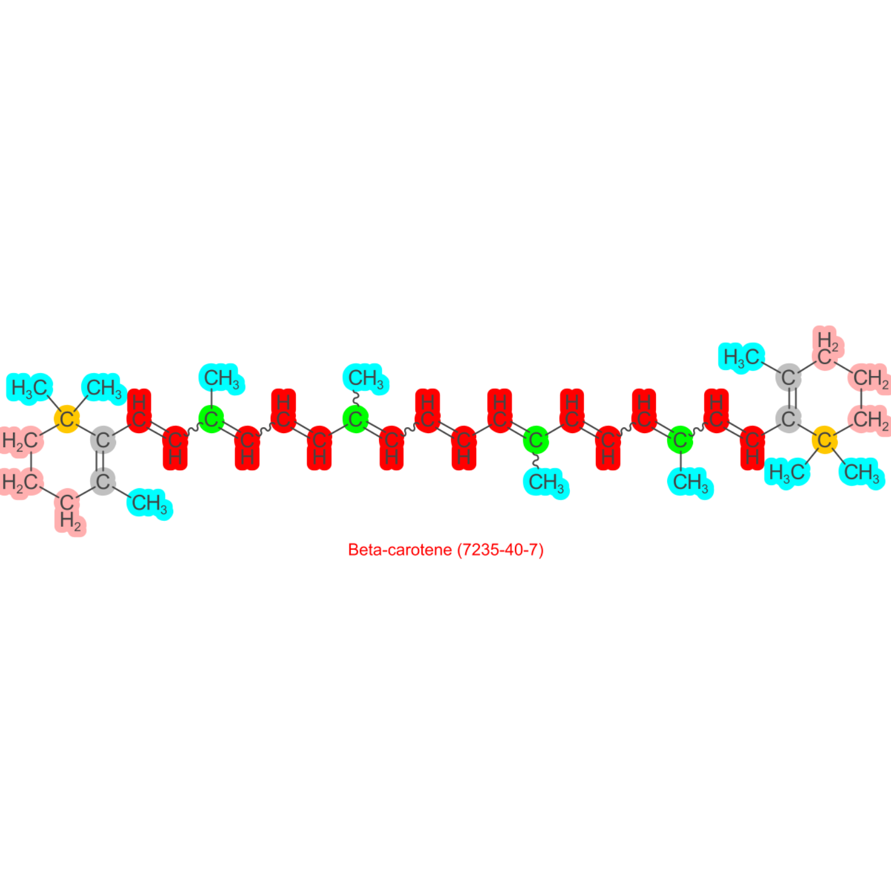
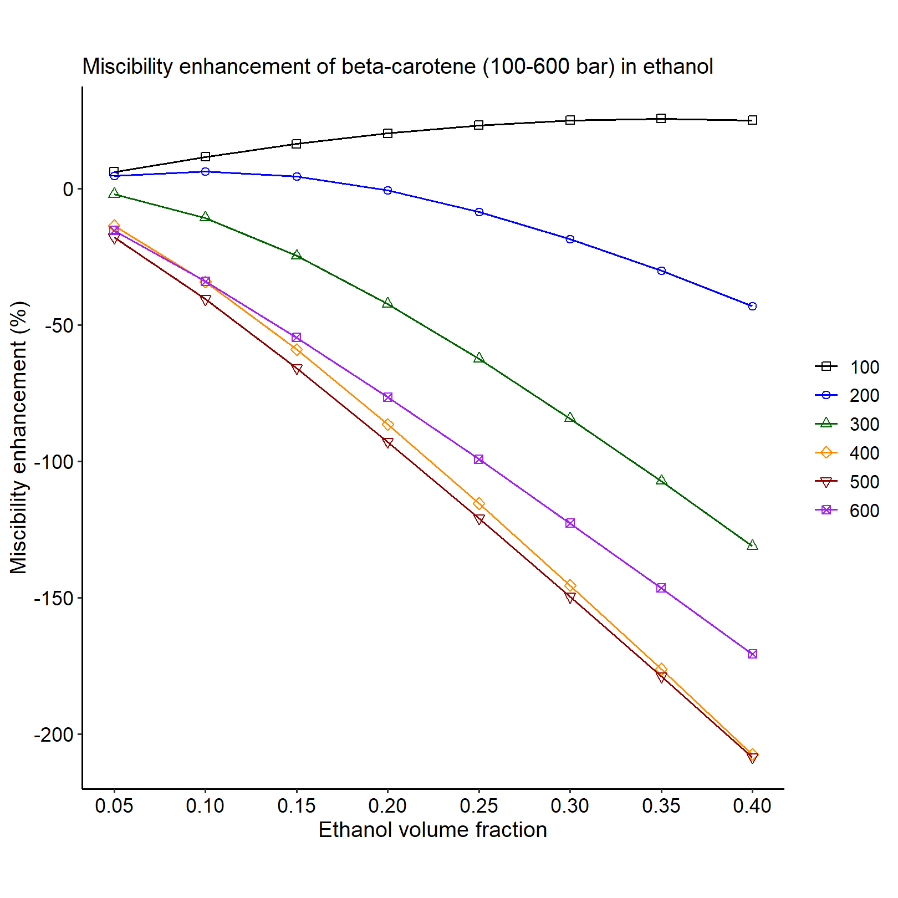
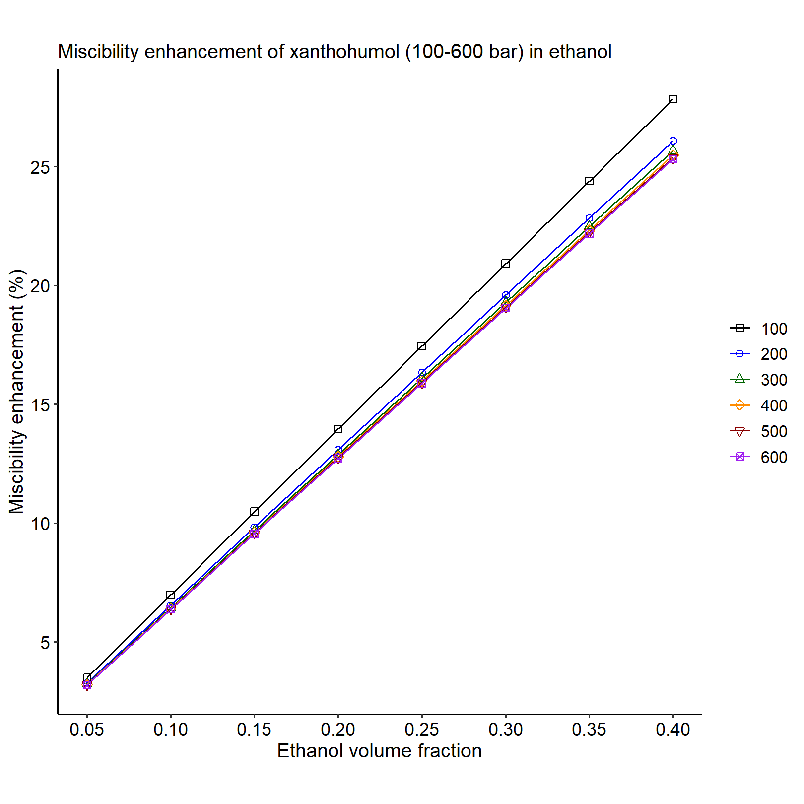

## Introduction

This vignette introduces the automated co-solvent selection and ranking workflow for Supercritical Fluid Extraction (SFE) processes, under the assumption that the reader is familiar with the technology. The choice of co-solvent composition and volume fraction (relative to CO~2~ flow), or indeed the choice of whether to use a co-solvent at all, is complicated by the different solubility of a target compound(s) contained in the extractable raw material, which is governed by its **cohesive energy density**, itself dependent on **the cohesive energy** and **molar volume**. The [Hansen Solubility Theory](https://www.hansen-solubility.com/HSP-science/basics.php) neatly defines the cohesive energy density of any given molecule (be it solute or solvent) as a set of solubility parameters (**HSP**s) describing the Dispersion, Polarity, and Hydrogen Bonding. These may be derived either experimentally via solubility trials or theoretically using [Group Contribution Methods](https://www.doi.org/10.1016/j.ejpb.2013.04.006) based on automated detection of functional groups from [SMILES](https://www.daylight.com/meetings/summerschool98/course/dave/smiles-intro.html) strings, [SMARTS](https://www.daylight.com/meetings/summerschool01/course/basics/smarts.html) notation, and other molecular descriptors.

The [official website](https://www.hansen-solubility.com) of the Hansen Solubility Theory and the accompanying [book](https://www.doi.org/10.1201/9781420006834) provide comprehensive information about the theory, while several real world applications (e.g. [here](https://www.doi.org/10.1016/j.ces.2018.06.017), [here](https://www.doi.org/10.3303/CET197502), and [here](https://doi.org/10.1016/j.jfoodeng.2025.112538)) give specific examples of its usefulness. In lieu of reciting their content herein, the reader is directed to familiarize themselves with both SFE and Hansen Solubility using the available sources. This vignette instead aims to provide a worked example(s) showcasing the capability of `supeRcrit` and the workflow encompassed by the `sfe_mod` function to help:

1.  [Retrieve molecular descriptors of a target compound](#moldesc).
2.  [Estimation of boiling point, critical parameters, and HSPs](#estgcm).
3.  [Estimate performance of various co-solvent for said compound](#sfemod).
4.  [Comparison of a single co-solvent for multiple targets, pressures, temperatures, and/or volume fractions](#miscomp).

## Worked examples

### Retrieval of molecular descriptors {#moldesc}

The workflow begins by retrieving molecular descriptors for a target compound. Although the `sfe_mod` function carries this out automatically, it is also useful as a separate function termed `mol_find`. All the user is required to provide is a target [CAS](https://www.cas.org/cas-data/cas-registry) number and preferred name of a molecule. Let's use beta-carotene as an example:


``` r
mol <- mol_find(c("Beta-carotene", "7235-40-7"))

#View results except InChI
mol$IDs[!names(mol$IDs) %in% "InChI"]
#>                                                                        Name 
#>                                                             "Beta-carotene" 
#>                                                                         CAS 
#>                                                                 "7235-40-7" 
#>                                                                      SMILES 
#> "CC1=C(C(CCC1)(C)C)C=CC(=CC=CC(=CC=CC=C(C)C=CC=C(C)C=CC2=C(CCCC2(C)C)C)C)C" 
#>                                                                    InChIKey 
#>                                               "OENHQHLEOONYIE-UHFFFAOYSA-N" 
#>                                                                  Atom_Count 
#>                                                                        "96" 
#>                                                                     H_Count 
#>                                                                        "56" 
#>                                                                          MW 
#>                                                             "536.438201792" 
#>                                                                          MF 
#>                                                                    "C40H56" 
#>                                                                 Aromaticity 
#>                                                                     "FALSE"
```

We can additionally provide the SMILES string explicitly if required:


``` r
#The SMILES string may also be specified:
mol_data <- c("7235-40-7", "Beta-carotene", "CC1=C(C(CCC1)(C)C)C=CC(=CC=CC(=CC=CC=C(C)C=CC=C(C)C=CC2=C(CCCC2(C)C)C)C)C")
mol <- mol_find(mol_data)
```

Although the function automatically determines the nature of input vector elements based on their formatting, the user may also explicitly name them as follows (**code not run**):


``` r
mol_find(c(CAS = "7235-40-7",
           Name = "Beta-carotene",
           SMILES = "CC1=C(C(CCC1)(C)C)C=CC(=CC=CC(=CC=CC=C(C)C=CC=C(C)C=CC2=C(CCCC2(C)C)C)C)C"))
```

### Estimation of boiling point, critical parameters, and HSPs {#estgcm}

The determination of co-solvent performance as target compound miscibility enhancers in supercritical CO~2~ requires estimation of their critical temperature and HSP values. Similarly to `mol_find`, the `sfe_mod` function handles this automatically, but a separate routine `est_gcm` provides this useful functionality as well. The function implements the [Joback-Reid](https://doi.org/10.1080/00986448708960487), [Stein and Brown](https://doi.org/10.1021/ci00019a016), [Nannoolal](https://doi.org/10.1016/j.fluid.2006.11.014), [Stefanis and Panayiotou](https://doi.org/10.1016/j.ijpharm.2012.01.001), and [Hukkerikar](https://doi.org/10.1016/j.fluid.2012.02.010) group contribution methods (GCMs) for estimating critical parameters and Hansen Solubility. Additionally, van der waals volume (in L mole^-1^) can be estimated by the methods of [Slonimskii](https://doi.org/10.1016/0032-3950(70)90345-X), [Bondi](https://doi.org/10.1021/j100785a001), and [Zhao](https://doi.org/10.1021/jo034808o). Once again using beta-carotene as an example:


``` r
gcm_res <- est_gcm(solute = mol_data,
                   tb = "SB_corr", #The corrected Stein and Brown method for boiling point estimation
                   crit = "JR", #Joback-Reid method for boiling point estimation
                   hsp = "SP12", #Stefanis and Panayiotou method for HSP estimation
                   vdw = "ZHAO", #Zhao method for van der Waals volume (VDW) estimation
                   silent = TRUE)

#Show estimated parameters
gcm_res[["pares"]][1:4]
#> $Critical
#>          Tb          Tc          Pc          Vc 
#>  856.307266 1048.530094    6.072617 1933.500000 
#> 
#> $HSP
#>       dD       dP      dHB 
#> 12.86394  3.62530  5.70970 
#> 
#> $VDW
#>          VDW 
#> 0.0003893736 
#> 
#> $Methods
#>        Tb  Critical       HSP       VDW 
#> "SB_corr"      "JR"    "SP12"    "ZHAO"

#Visualise the fragmentation patterns (example given is for Stein and Brown boiling point estimation method)
grid::grid.raster(gcm_res[["visres"]][["Tb"]][[1]], width = 1, height = 1, vp = grid::viewport(xscale = c(0,1), yscale = c(0,1)))
```

<div class="figure">

<p class="caption">plot of chunk estgcm_1</p>
</div>

All GCM approaches require fragmentation of a molecular structure into discrete representative groups where overlapping atoms between identified groups are either permitted or disallowed depending on the selected method. Manual group fragmentation may be time-consuming and in this package various automatic fragmentation approaches are instead employed, most of these were inspired by the work of [Peter Ertl](https://doi.org/10.1186/s13321-017-0225-z) and [Simon Müller](https://doi.org/10.1186/s13321-019-0382-3). The `simplicity` argument (rather fittingly) determines the level of simplicity of the automatic fragmentation algorithm. Besides the default setting, `"auto"`, the three possible values are:

-   `"simple"`: Group overlap is allowed.
-   `"normal"`: Group overlap is not allowed, with the first valid fragmentation pattern accepted.
-   `"complex"`: Group overlap is not allowed and every possible fragmentation pattern is computed before final selection.

Note that the above are overridden for second- and third-order groups, where the parameters of fragmentation are the same as those originally published (for more detail, the reader is referred to the primary literature linked throughout this document). For some molecules, the `"complex"` approach may take hours to settle on a single fragmentation pattern out of possible thousands, but for others (like 2-methylphenanthrene exemplified below) the routine is surprisingly fast. Nevertheless, the remaining two approaches are significantly more practical, but still differ in execution time and performance:


``` r
#Define a new molecule which should contain groups of multiple orders
mol_data <- c("2531-84-2", "2-methylphenanthrene")
mol <- mol_find(mol_data)

#Compare the fragmentation time using the Hukkerikar approach for critical parameter estimation
taken <- c()
start_1 <- Sys.time()
res_simple <- est_gcm(solute = mol_data, crit = "HKR_STW", simplicity = "simple", silent = TRUE)
end_1 <- Sys.time()
taken["simple"] <- round(end_1 - start_1, 2)

#For the 'normal' simplicity level
start_2 <- Sys.time()
res_normal <- est_gcm(solute = mol_data, crit = "HKR_STW", simplicity = "normal", silent = TRUE)
end_2 <- Sys.time()
taken["normal"] <- round(end_2 - start_2, 2)

#For the 'complex' simplicity level
start_3 <- Sys.time()
res_complex <- est_gcm(solute = mol_data, crit = "HKR_STW", simplicity = "complex", silent = TRUE)
end_3 <- Sys.time()
taken["complex"] <- round(end_3 - start_3, 2)
taken
#>  simple  normal complex 
#>    8.05    6.49    7.26
```

We see that, somewhat surprisingly, the `simple` approach is slower than the more complex `normal` setting, while the `complex` fragmentation is only slightly more time-consuming for such a small molecule. Let us check the results in more detail:


``` r
reslist <- list(res_simple, res_normal, res_complex)

#Retrieve and show estimated critical temperatures
setNames(sapply(reslist, function(x) x[["pares"]][["Critical"]][["Tc"]]), c("simple_Tc", "normal_Tc", "complex_Tc"))
#>  simple_Tc  normal_Tc complex_Tc 
#>   859.9909   859.9909   859.9909

#Show the number of UNIQUE identified groups
setNames(sapply(reslist, function(x) nrow(x[["pares"]][["Contribs"]][["Critical"]])), c("simple_groups", "normal_groups", "complex_groups"))
#>  simple_groups  normal_groups complex_groups 
#>              3              3              3
```

We see that the `simple` method likely vastly overestimates the critical temperature due to the overabundance of identified groups, while there is no need for the `complex` approach in this case since it results in the same estimation as the more time-efficient `normal` approach.

Finally, some GCMs examine multiple levels of functional groups, otherwise known as **group orders**, to refine initial estimates from the so-called first-order groups. This can also alter estimates as exemplified below using the `gorder` argument:


``` r
#By default, consider all groups (first- and second-order in this case)
res1 <- est_gcm(solute = mol_data, hsp = "SP12", gorder = 0, silent = TRUE)

#Consider only first-order groups
res2 <- est_gcm(solute = mol_data, hsp = "SP12", gorder = 1, silent = TRUE)

res1[["pares"]][["HSP"]]
#>       dD       dP      dHB 
#> 20.72574  1.36840  4.98000
res2[["pares"]][["HSP"]]
#>       dD       dP      dHB 
#> 21.26372  4.86270  1.60640
```

Naturally, given the variety of underlying models, different GCMs result in slightly (and sometimes significantly) different parameter estimates. These differences may be quickly displayed via the `compare_gcm` function as below:


``` r
cgcm <- compare_gcm(mol_data, simplicity = "simple")
#> 
#> Estimating values using method: JR...
Estimating values using method: JR_corr...
Estimating values using method: SB...
Estimating values using method: SB_corr...
Estimating values using method: NL04...
Estimating values using method: HKR_STW...
Estimating values using method: HKR_SIM...
Estimating values using method: JR...
Estimating values using method: NL07...
Estimating values using method: NL07_robust...
Estimating values using method: HKR_STW...
Estimating values using method: HKR_SIM...
Estimating values using method: SP08...
Estimating values using method: SP12...
Estimating values using method: HKR_STW...
Estimating values using method: HKR_SIM...
Estimating values using method: BND...
Estimating values using method: SLON...
Estimating values using method: ZHAO...
Estimating values using method: CHRASTIL...
knitr::kable(cgcm, format = "html", digits = 2) |>  kableExtra::kable_styling(full_width = T)
```

<table class="table" style="margin-left: auto; margin-right: auto;">
 <thead>
  <tr>
   <th style="text-align:left;"> parameter </th>
   <th style="text-align:left;"> method </th>
   <th style="text-align:left;"> simplicity </th>
   <th style="text-align:left;"> order </th>
   <th style="text-align:right;"> Tb </th>
   <th style="text-align:right;"> Tc </th>
   <th style="text-align:right;"> Pc </th>
   <th style="text-align:right;"> Vc </th>
   <th style="text-align:right;"> dD </th>
   <th style="text-align:right;"> dP </th>
   <th style="text-align:right;"> dHB </th>
   <th style="text-align:right;"> VDW </th>
   <th style="text-align:right;"> k </th>
   <th style="text-align:right;"> A </th>
   <th style="text-align:right;"> B </th>
  </tr>
 </thead>
<tbody>
  <tr>
   <td style="text-align:left;"> tb </td>
   <td style="text-align:left;"> JR </td>
   <td style="text-align:left;"> simple </td>
   <td style="text-align:left;"> 1 </td>
   <td style="text-align:right;"> 617.40 </td>
   <td style="text-align:right;"> NA </td>
   <td style="text-align:right;"> NA </td>
   <td style="text-align:right;"> NA </td>
   <td style="text-align:right;"> NA </td>
   <td style="text-align:right;"> NA </td>
   <td style="text-align:right;"> NA </td>
   <td style="text-align:right;"> NA </td>
   <td style="text-align:right;"> NA </td>
   <td style="text-align:right;"> NA </td>
   <td style="text-align:right;"> NA </td>
  </tr>
  <tr>
   <td style="text-align:left;"> tb </td>
   <td style="text-align:left;"> JR_corr </td>
   <td style="text-align:left;"> simple </td>
   <td style="text-align:left;"> 1 </td>
   <td style="text-align:right;"> 573.18 </td>
   <td style="text-align:right;"> NA </td>
   <td style="text-align:right;"> NA </td>
   <td style="text-align:right;"> NA </td>
   <td style="text-align:right;"> NA </td>
   <td style="text-align:right;"> NA </td>
   <td style="text-align:right;"> NA </td>
   <td style="text-align:right;"> NA </td>
   <td style="text-align:right;"> NA </td>
   <td style="text-align:right;"> NA </td>
   <td style="text-align:right;"> NA </td>
  </tr>
  <tr>
   <td style="text-align:left;"> tb </td>
   <td style="text-align:left;"> SB </td>
   <td style="text-align:left;"> simple </td>
   <td style="text-align:left;"> 1 </td>
   <td style="text-align:right;"> 630.75 </td>
   <td style="text-align:right;"> NA </td>
   <td style="text-align:right;"> NA </td>
   <td style="text-align:right;"> NA </td>
   <td style="text-align:right;"> NA </td>
   <td style="text-align:right;"> NA </td>
   <td style="text-align:right;"> NA </td>
   <td style="text-align:right;"> NA </td>
   <td style="text-align:right;"> NA </td>
   <td style="text-align:right;"> NA </td>
   <td style="text-align:right;"> NA </td>
  </tr>
  <tr>
   <td style="text-align:left;"> tb </td>
   <td style="text-align:left;"> SB_corr </td>
   <td style="text-align:left;"> simple </td>
   <td style="text-align:left;"> 1 </td>
   <td style="text-align:right;"> 581.14 </td>
   <td style="text-align:right;"> NA </td>
   <td style="text-align:right;"> NA </td>
   <td style="text-align:right;"> NA </td>
   <td style="text-align:right;"> NA </td>
   <td style="text-align:right;"> NA </td>
   <td style="text-align:right;"> NA </td>
   <td style="text-align:right;"> NA </td>
   <td style="text-align:right;"> NA </td>
   <td style="text-align:right;"> NA </td>
   <td style="text-align:right;"> NA </td>
  </tr>
  <tr>
   <td style="text-align:left;"> tb </td>
   <td style="text-align:left;"> NL04 </td>
   <td style="text-align:left;"> simple </td>
   <td style="text-align:left;"> 2 </td>
   <td style="text-align:right;"> 616.70 </td>
   <td style="text-align:right;"> NA </td>
   <td style="text-align:right;"> NA </td>
   <td style="text-align:right;"> NA </td>
   <td style="text-align:right;"> NA </td>
   <td style="text-align:right;"> NA </td>
   <td style="text-align:right;"> NA </td>
   <td style="text-align:right;"> NA </td>
   <td style="text-align:right;"> NA </td>
   <td style="text-align:right;"> NA </td>
   <td style="text-align:right;"> NA </td>
  </tr>
  <tr>
   <td style="text-align:left;"> tb </td>
   <td style="text-align:left;"> HKR_STW </td>
   <td style="text-align:left;"> simple </td>
   <td style="text-align:left;"> 3 </td>
   <td style="text-align:right;"> 614.19 </td>
   <td style="text-align:right;"> NA </td>
   <td style="text-align:right;"> NA </td>
   <td style="text-align:right;"> NA </td>
   <td style="text-align:right;"> NA </td>
   <td style="text-align:right;"> NA </td>
   <td style="text-align:right;"> NA </td>
   <td style="text-align:right;"> NA </td>
   <td style="text-align:right;"> NA </td>
   <td style="text-align:right;"> NA </td>
   <td style="text-align:right;"> NA </td>
  </tr>
  <tr>
   <td style="text-align:left;"> tb </td>
   <td style="text-align:left;"> HKR_SIM </td>
   <td style="text-align:left;"> simple </td>
   <td style="text-align:left;"> 3 </td>
   <td style="text-align:right;"> 625.46 </td>
   <td style="text-align:right;"> NA </td>
   <td style="text-align:right;"> NA </td>
   <td style="text-align:right;"> NA </td>
   <td style="text-align:right;"> NA </td>
   <td style="text-align:right;"> NA </td>
   <td style="text-align:right;"> NA </td>
   <td style="text-align:right;"> NA </td>
   <td style="text-align:right;"> NA </td>
   <td style="text-align:right;"> NA </td>
   <td style="text-align:right;"> NA </td>
  </tr>
  <tr>
   <td style="text-align:left;"> crit </td>
   <td style="text-align:left;"> JR </td>
   <td style="text-align:left;"> simple </td>
   <td style="text-align:left;"> 1 </td>
   <td style="text-align:right;"> NA </td>
   <td style="text-align:right;"> 815.73 </td>
   <td style="text-align:right;"> 28.69 </td>
   <td style="text-align:right;"> 611.50 </td>
   <td style="text-align:right;"> NA </td>
   <td style="text-align:right;"> NA </td>
   <td style="text-align:right;"> NA </td>
   <td style="text-align:right;"> NA </td>
   <td style="text-align:right;"> NA </td>
   <td style="text-align:right;"> NA </td>
   <td style="text-align:right;"> NA </td>
  </tr>
  <tr>
   <td style="text-align:left;"> crit </td>
   <td style="text-align:left;"> NL07 </td>
   <td style="text-align:left;"> simple </td>
   <td style="text-align:left;"> 2 </td>
   <td style="text-align:right;"> NA </td>
   <td style="text-align:right;"> 828.74 </td>
   <td style="text-align:right;"> 30.29 </td>
   <td style="text-align:right;"> 625.58 </td>
   <td style="text-align:right;"> NA </td>
   <td style="text-align:right;"> NA </td>
   <td style="text-align:right;"> NA </td>
   <td style="text-align:right;"> NA </td>
   <td style="text-align:right;"> NA </td>
   <td style="text-align:right;"> NA </td>
   <td style="text-align:right;"> NA </td>
  </tr>
  <tr>
   <td style="text-align:left;"> crit </td>
   <td style="text-align:left;"> NL07_robust </td>
   <td style="text-align:left;"> simple </td>
   <td style="text-align:left;"> 2 </td>
   <td style="text-align:right;"> NA </td>
   <td style="text-align:right;"> 828.74 </td>
   <td style="text-align:right;"> 30.29 </td>
   <td style="text-align:right;"> 625.58 </td>
   <td style="text-align:right;"> NA </td>
   <td style="text-align:right;"> NA </td>
   <td style="text-align:right;"> NA </td>
   <td style="text-align:right;"> NA </td>
   <td style="text-align:right;"> NA </td>
   <td style="text-align:right;"> NA </td>
   <td style="text-align:right;"> NA </td>
  </tr>
  <tr>
   <td style="text-align:left;"> crit </td>
   <td style="text-align:left;"> HKR_STW </td>
   <td style="text-align:left;"> simple </td>
   <td style="text-align:left;"> 3 </td>
   <td style="text-align:right;"> NA </td>
   <td style="text-align:right;"> 859.99 </td>
   <td style="text-align:right;"> 29.08 </td>
   <td style="text-align:right;"> 624.48 </td>
   <td style="text-align:right;"> NA </td>
   <td style="text-align:right;"> NA </td>
   <td style="text-align:right;"> NA </td>
   <td style="text-align:right;"> NA </td>
   <td style="text-align:right;"> NA </td>
   <td style="text-align:right;"> NA </td>
   <td style="text-align:right;"> NA </td>
  </tr>
  <tr>
   <td style="text-align:left;"> crit </td>
   <td style="text-align:left;"> HKR_SIM </td>
   <td style="text-align:left;"> simple </td>
   <td style="text-align:left;"> 3 </td>
   <td style="text-align:right;"> NA </td>
   <td style="text-align:right;"> 859.99 </td>
   <td style="text-align:right;"> 29.14 </td>
   <td style="text-align:right;"> 539.99 </td>
   <td style="text-align:right;"> NA </td>
   <td style="text-align:right;"> NA </td>
   <td style="text-align:right;"> NA </td>
   <td style="text-align:right;"> NA </td>
   <td style="text-align:right;"> NA </td>
   <td style="text-align:right;"> NA </td>
   <td style="text-align:right;"> NA </td>
  </tr>
  <tr>
   <td style="text-align:left;"> hsp </td>
   <td style="text-align:left;"> SP08 </td>
   <td style="text-align:left;"> simple </td>
   <td style="text-align:left;"> 2 </td>
   <td style="text-align:right;"> NA </td>
   <td style="text-align:right;"> NA </td>
   <td style="text-align:right;"> NA </td>
   <td style="text-align:right;"> NA </td>
   <td style="text-align:right;"> 20.79 </td>
   <td style="text-align:right;"> 1.23 </td>
   <td style="text-align:right;"> 5.04 </td>
   <td style="text-align:right;"> NA </td>
   <td style="text-align:right;"> NA </td>
   <td style="text-align:right;"> NA </td>
   <td style="text-align:right;"> NA </td>
  </tr>
  <tr>
   <td style="text-align:left;"> hsp </td>
   <td style="text-align:left;"> SP12 </td>
   <td style="text-align:left;"> simple </td>
   <td style="text-align:left;"> 2 </td>
   <td style="text-align:right;"> NA </td>
   <td style="text-align:right;"> NA </td>
   <td style="text-align:right;"> NA </td>
   <td style="text-align:right;"> NA </td>
   <td style="text-align:right;"> 20.73 </td>
   <td style="text-align:right;"> 1.37 </td>
   <td style="text-align:right;"> 4.98 </td>
   <td style="text-align:right;"> NA </td>
   <td style="text-align:right;"> NA </td>
   <td style="text-align:right;"> NA </td>
   <td style="text-align:right;"> NA </td>
  </tr>
  <tr>
   <td style="text-align:left;"> hsp </td>
   <td style="text-align:left;"> HKR_STW </td>
   <td style="text-align:left;"> simple </td>
   <td style="text-align:left;"> 3 </td>
   <td style="text-align:right;"> NA </td>
   <td style="text-align:right;"> NA </td>
   <td style="text-align:right;"> NA </td>
   <td style="text-align:right;"> NA </td>
   <td style="text-align:right;"> 21.05 </td>
   <td style="text-align:right;"> 0.00 </td>
   <td style="text-align:right;"> 0.00 </td>
   <td style="text-align:right;"> NA </td>
   <td style="text-align:right;"> NA </td>
   <td style="text-align:right;"> NA </td>
   <td style="text-align:right;"> NA </td>
  </tr>
  <tr>
   <td style="text-align:left;"> hsp </td>
   <td style="text-align:left;"> HKR_SIM </td>
   <td style="text-align:left;"> simple </td>
   <td style="text-align:left;"> 3 </td>
   <td style="text-align:right;"> NA </td>
   <td style="text-align:right;"> NA </td>
   <td style="text-align:right;"> NA </td>
   <td style="text-align:right;"> NA </td>
   <td style="text-align:right;"> 18.90 </td>
   <td style="text-align:right;"> 2.57 </td>
   <td style="text-align:right;"> 0.00 </td>
   <td style="text-align:right;"> NA </td>
   <td style="text-align:right;"> NA </td>
   <td style="text-align:right;"> NA </td>
   <td style="text-align:right;"> NA </td>
  </tr>
  <tr>
   <td style="text-align:left;"> vdw </td>
   <td style="text-align:left;"> BND </td>
   <td style="text-align:left;"> simple </td>
   <td style="text-align:left;"> 1 </td>
   <td style="text-align:right;"> NA </td>
   <td style="text-align:right;"> NA </td>
   <td style="text-align:right;"> NA </td>
   <td style="text-align:right;"> NA </td>
   <td style="text-align:right;"> NA </td>
   <td style="text-align:right;"> NA </td>
   <td style="text-align:right;"> NA </td>
   <td style="text-align:right;"> 0 </td>
   <td style="text-align:right;"> NA </td>
   <td style="text-align:right;"> NA </td>
   <td style="text-align:right;"> NA </td>
  </tr>
  <tr>
   <td style="text-align:left;"> vdw </td>
   <td style="text-align:left;"> SLON </td>
   <td style="text-align:left;"> simple </td>
   <td style="text-align:left;"> 1 </td>
   <td style="text-align:right;"> NA </td>
   <td style="text-align:right;"> NA </td>
   <td style="text-align:right;"> NA </td>
   <td style="text-align:right;"> NA </td>
   <td style="text-align:right;"> NA </td>
   <td style="text-align:right;"> NA </td>
   <td style="text-align:right;"> NA </td>
   <td style="text-align:right;"> 0 </td>
   <td style="text-align:right;"> NA </td>
   <td style="text-align:right;"> NA </td>
   <td style="text-align:right;"> NA </td>
  </tr>
  <tr>
   <td style="text-align:left;"> vdw </td>
   <td style="text-align:left;"> ZHAO </td>
   <td style="text-align:left;"> simple </td>
   <td style="text-align:left;"> 1 </td>
   <td style="text-align:right;"> NA </td>
   <td style="text-align:right;"> NA </td>
   <td style="text-align:right;"> NA </td>
   <td style="text-align:right;"> NA </td>
   <td style="text-align:right;"> NA </td>
   <td style="text-align:right;"> NA </td>
   <td style="text-align:right;"> NA </td>
   <td style="text-align:right;"> 0 </td>
   <td style="text-align:right;"> NA </td>
   <td style="text-align:right;"> NA </td>
   <td style="text-align:right;"> NA </td>
  </tr>
  <tr>
   <td style="text-align:left;"> chrastil </td>
   <td style="text-align:left;"> CHRASTIL </td>
   <td style="text-align:left;"> simple </td>
   <td style="text-align:left;"> 0 </td>
   <td style="text-align:right;"> NA </td>
   <td style="text-align:right;"> NA </td>
   <td style="text-align:right;"> NA </td>
   <td style="text-align:right;"> NA </td>
   <td style="text-align:right;"> NA </td>
   <td style="text-align:right;"> NA </td>
   <td style="text-align:right;"> NA </td>
   <td style="text-align:right;"> NA </td>
   <td style="text-align:right;"> 3.85 </td>
   <td style="text-align:right;"> -4811.11 </td>
   <td style="text-align:right;"> -17.37 </td>
  </tr>
</tbody>
</table>


While the values are often consistent between methods, it is recommended to survey the results are much as possible for each individual target compound before settling on a particular set of GCMs, since the accuracy of predicted parameters significantly impacts subsequent co-solvent performance estimation.

### Estimation of co-solvent performance for one compound {#sfemod}

The `sfe_mod` routine uses the [Hansen Solubility Theory](https://www.hansen-solubility.com/HSP-science/basics.php) to estimate the **relative** improvement in the miscibility of a target compound (the so-called *% Miscibility Enhancement*) in a **binary CO2 : co-solvent system** of a specified composition. This allows one to determine whether addition of a specific co-solvent(s) at various concentrations improves the solubility of a target compound relative to pure supercritical CO~2~, and how said improvements compare between different solvents.

The general approach is based on the work of [Diego Tirado](https://doi.org/10.1016/j.supflu.2018.12.013) and involves several steps:

1.  Calculation of the temperature influence on the HSP of the target compound using [Jayasri & Yaseen][jyas] nomograms.
2.  Calculation of mole fractions (from the provided volume fraction) of the binary system.
3.  Derivation of the average molar volume at a **specified range of process temperatures and pressures** from the binary system composition.
4.  Calculation of the influence of the molar volume at each set of conditions on the HSP parameters of the binary system.
5.  Calculation of the **solubility parameter distance**, ***Ra***, for pure CO~2~ and each binary CO~2~ : co-solvent system.
6.  Conversion of the *Ra* metric into *% Miscibility Enhancement* relative to pure CO~2~.

The solvent systems are finally ranked at each possible set of conditions within the user-specified range, and the system providing the largest miscibility enhancement is chosen as the "best".

Let us determine the miscibility enhancement for xanthohumol, a prenylflavonoid commonly found in hops and poorly soluble in supercritical CO~2~, using various co-solvents at a volume fraction of 0.1.


``` r
xantho <- c(hspex[hspex[,"Name"] == "Xanthohumol",c("SMILES", "CAS", "Name")])

res <- sfe_mod(solute = xantho,
               tb = "SB_corr",
               pres = seq_last(80, 400, 60),
               temp = seq_last(32, 70, 9),
               vfrac = 0.1,
               crit = "NL07_robust",
               hsp = "SP12",
               simplicity = "normal")
#> 
#> Retrieving compound data...
#> Calculating/retrieving boiling point ...
#> Calculating/retrieving critical temperature and other parameters ...
#> Calculating/retrieving Hansen Solubility Parameters (HSP) ...
#> Rounding SFE temperature and pressure constraints to whole numbers...
#> Calculating SFE miscibility enhancement using a 0.1 volume fraction of the following modifiers: 'Acetone', 'Benzene', 'Cyclohexane', 'DiethylEther', 'Ethanol', 'Heptane', 'Hexane', 'Methanol', 'MethylOleate', 'Toluene', 'PXylene', 'OXylene', 'Water'.
#> Calculating temperature influence of HSP values of solute...
#> Processing molar volumes...
#> Calculating the temperature and pressure influence on HSP of solvent(s)...
#> Calculating Ra distances and Miscibility Enhancement (%)...
#> DONE!

#Check the list of evaluated solvents
res[["sfe"]][["Modifiers"]]
#>  [1] "Acetone"      "Benzene"      "Cyclohexane"  "DiethylEther" "Ethanol"     
#>  [6] "Heptane"      "Hexane"       "Methanol"     "MethylOleate" "Toluene"     
#> [11] "PXylene"      "OXylene"      "Water"

#Display the best solvent at each set of conditions (80-400 bar and 32-70 C)
res[["sfe"]][["Best_Modifier"]]
#>     32    41    50    59    68    70   
#> 80  "H2O" "H2O" "H2O" "H2O" "H2O" "H2O"
#> 140 "H2O" "H2O" "H2O" "H2O" "H2O" "H2O"
#> 200 "H2O" "H2O" "H2O" "H2O" "H2O" "H2O"
#> 260 "H2O" "H2O" "H2O" "H2O" "H2O" "H2O"
#> 320 "H2O" "H2O" "H2O" "H2O" "H2O" "H2O"
#> 380 "H2O" "H2O" "H2O" "H2O" "H2O" "H2O"
#> 400 "H2O" "H2O" "H2O" "H2O" "H2O" "H2O"

#Display the overall ranking (based on the proportion of conditions at which a particular solvent provides the highest enhancement)
res[["sfe"]][["Modifier_Ranking"]]
#> 
#> H2O 
#> 100
```

It appears that using water as a co-solvent provides by far the best enhancement of miscibility throughout the tested temperature and pressure range. However, let us compare the miscibility enhancement obtained with other solvents to see whether any show similar performance.


``` r
solv_list <- c("Hexane", "Toluene", "Methanol", "Ethanol", "Water")
reslist <- list()
for(i in solv_list){
  reslist[[paste0("CO2 with ",i)]] <- c(i, round(range(res[["sfe"]][["Miscib_Enhancement"]][[paste0("CO2 with ", i)]]),2))
}
setNames(Reduce("rbind.data.frame", reslist), c("Co-solvent", "Min", "Max"))
#>   Co-solvent   Min   Max
#> 1     Hexane -0.92  5.42
#> 2    Toluene  1.06  7.28
#> 3   Methanol  6.71  7.63
#> 4    Ethanol  6.32  7.93
#> 5      Water  9.86 13.87
```

The table of minimum and maximum miscibility enhancements reveals that while water is the best modifier, both ethanol and methanol are also likely to benefit the extraction of xanthohumol. What if we were to use a mixture of ethanol and water (e.g. 1:1)? Let us try.


``` r
res <- sfe_mod(solute = xantho,
               modif = list(c("Ethanol", "Water"), "Water"),
               modfracs = list(50),
               tb = "SB_corr",
               crit = "NL07_robust",
               hsp = "SP12",
               pres = seq_last(80, 400, 60),
               temp = seq_last(32, 70, 9),
               vfrac = 0.1,
               simplicity = "normal",
               silent = TRUE)

res[["sfe"]][["Miscib_Enhancement"]]
#> $`CO2 with Ethanol:Water (50:50)`
#>            32        41        50        59        68        70
#> 80   9.195742  8.907829  8.909939  8.927255  8.949503  8.954209
#> 140  9.547553  9.493513  9.430192  9.367726  9.327000  9.323150
#> 200  9.733991  9.713131  9.691350  9.668115  9.647679  9.643608
#> 260  9.880518  9.876685  9.874115  9.871843  9.871150  9.870777
#> 320 10.005138 10.013894 10.023425 10.035163 10.047880 10.051237
#> 380 10.115042 10.132567 10.152700 10.174066 10.197963 10.204097
#> 400 10.148760 10.168965 10.192042 10.216101 10.243538 10.249978
#> 
#> $`CO2 with Water`
#>           32       41        50        59       68        70
#> 80  11.36461 10.00895  9.904563  9.871778  9.86297  9.862818
#> 140 12.43678 12.12951 11.769859 11.385399 11.07212 11.020535
#> 200 12.91194 12.72059 12.515701 12.299454 12.08262 12.035311
#> 260 13.26329 13.12526 12.982901 12.835569 12.68618 12.653134
#> 320 13.55012 13.44828 13.343190 13.236318 13.12944 13.106655
#> 380 13.79749 13.72079 13.643555 13.564854 13.48892 13.472923
#> 400 13.87273 13.80271 13.734148 13.663552 13.59661 13.581589
```

It appears that the performance of 1:1 ethanol:water as a co-solvent is somewhere between that of pure ethanol and water, as expected.

The output of `sfe_mod` may be exported as a .CSV file using the `hsp_export` function (**code not run**):


``` r
hsp_export(res,
           expath = "C:/HSP") #Hypothetical export path as a string
```

### Comparison of co-solvents for various targets, temperatures, and/or pressures {#miscomp}

Sometimes it is beneficial to survey co-solvent performance for different target compounds at various ranges of process pressure, temperature, and co-solvent volume fraction relative to that of CO~2~. The function `miscomp` simplifies this with visual representations of miscibility enhancement as shown below.


``` r
#fig.height = 15, fig.width = 7.5
#Define two analytes to compare
mol1 <- c(hspex[1,c("SMILES", "CAS", "Name")]) #Beta-carotene
mol2 <- c(hspex[24,c("SMILES", "CAS", "Name")]) #Xanthohumol

#Compare miscibility enhancement
gcm_comp <- miscomp(sols = list(mol1, mol2), simplicity = "normal") #Uses default volume fraction, pressure range, temperature etc.
#> 
#> Working on compound 1 of 2 ...
#> Calculating HSPs and other parameters...
#> Calculating miscibility enhancement...
#> Compiling data...
#> Working on compound 2 of 2 ...
#> Calculating HSPs and other parameters...
#> Calculating miscibility enhancement...
#> Compiling data...

#Display plots for both compounds
gcm_comp[["plots"]][["Beta-carotene"]]
```

<div class="figure">

<p class="caption">plot of chunk miscomp_1</p>
</div>

``` r
gcm_comp[["plots"]][["Xanthohumol"]]
```

<div class="figure">

<p class="caption">plot of chunk miscomp_1</p>
</div>

It is apparent that addition of ethanol as a co-solvent does not result in a miscibility improvement for beta-carotene (and may even be detrimental to solubility), while the significantly more hydrophilic xanthohumol benefits significantly throughout the examined pressure range.

## A machine-learned solubility workflow

The Hansen workflow above ranks co-solvents by a *relative* miscibility metric (the change in the HSP distance *Ra*). `supeRcrit` also ships a complementary, fully data-driven route that predicts the **absolute** supercritical-CO~2~ solubility of a solute — and the enhancement a co-solvent provides — directly from a SMILES string. These models are written in native R (no Python dependency) and reimplement the "thermodynamics-informed machine learning" approach of [Makarov et al.](https://doi.org/10.1016/j.supflu.2024.106241), trained on large open experimental datasets.

### Estimating molecular properties from SMILES

Two gradient-boosted-tree estimators predict pure-component properties that are useful both downstream and in their own right. The melting point `gcm_mp` is trained on the open Jean-Claude Bradley dataset (~24k compounds); the enthalpy of vaporization `gcm_hvap` shares the same feature pipeline:


``` r
gcm_mp("CC(=O)Nc1ccc(O)cc1")          # paracetamol, ~441 K (experimental 442 K)
#> [1] 445.6656
#> attr(,"model")
#> [1] "xgboost | Bradley(~24k full)+CHAOS sigma-profile, xgboost (n=23698, test RMSE 40 K, MAE 27 K, R2 0.81)"
gcm_mp("CC(=O)Nc1ccc(O)cc1", "C")     # the same value expressed in Celsius
#> [1] 172.5156
#> attr(,"model")
#> [1] "xgboost | Bradley(~24k full)+CHAOS sigma-profile, xgboost (n=23698, test RMSE 40 K, MAE 27 K, R2 0.81)"
gcm_hvap("CCO")                        # ethanol, ~35 kJ/mol
#> [1] 34.69535
#> attr(,"model")
#> [1] "xgboost | Makarov dHvap (1047 full)+CHAOS, xgboost (n=1047, test RMSE 6.2 kJ/mol, R2 0.95)"
```

The five [Abraham](https://doi.org/10.1039/c3cs60042j) LSER solute descriptors (E, S, A, B, V) used by the solubility model can be obtained directly:


``` r
abraham_params(c("c1ccccc1", "CCO"))   # benzene and ethanol
#>              E         S           A         B         V
#> [1,] 0.6999953 0.5455228 0.006108997 0.1207979 0.7309862
#> [2,] 0.2579784 0.4409472 0.371581852 0.5277647 0.4431136
```

### Predicting supercritical-CO~2~ solubility

`predict_solubility` returns the equilibrium solubility (solute mole fraction *y*~2~ in the CO~2~-rich phase) over a temperature/pressure grid, optionally with a liquid co-solvent at a given mole fraction. It needs only the solute SMILES and operating conditions — the melting point is estimated with `gcm_mp` when not supplied, or can be passed explicitly via `Tm`:


``` r
#Naphthalene in pure CO2 at 308 K across a pressure range
predict_solubility("c1ccc2ccccc2c1", temp = 308, pres = c(100, 150, 200, 250))
#>   temp_K pres_bar   log10_y   mole_frac
#> 1    308      100 -2.613637 0.002434235
#> 2    308      150 -2.437853 0.003648775
#> 3    308      200 -2.271966 0.005346059
#> 4    308      250 -2.193202 0.006409121

#Paracetamol with 5 mol% methanol as a co-solvent
predict_solubility("CC(=O)Nc1ccc(O)cc1", temp = 318, pres = 200, cosolvent = "CO", x = 0.05)
#>   temp_K pres_bar   log10_y    mole_frac
#> 1    318      200 -4.697251 2.007933e-05
```

The model is reliable within roughly **308–373 K and 80–360 bar**. Mole-fraction solubilities convert to a mass loading (g of solute per kg of CO~2~) with `solub_gkg`:


``` r
solub_gkg(1.7e-4, 151.2)               # paracetamol-like, ~0.58 g/kg
#> [1] 0.5841484
```

### Ranking co-solvents by predicted solubility enhancement

`solub_optim` is the solubility analogue of `hsp_optim`: for one solute it evaluates `predict_solubility` over a pressure/temperature grid for pure CO~2~ and for each candidate co-solvent, returning each co-solvent's **enhancement ratio** (*y*~2~ with co-solvent divided by *y*~2~ in pure CO~2~) together with the absolute solubility. SMILES for the bundled Hansen solvents are available from `show_solv()`:


``` r
cs <- setNames(show_solv()$SMILES, show_solv()$Solvent)

sc <- solub_optim("CC(=O)Nc1ccc(O)cc1",
                  cosolvents = cs[c("Ethanol", "Acetone", "Methanol", "Hexane")],
                  temp_C = c(40, 50, 60), pres_bar = c(150, 200, 250), x = 0.05)

#Mean enhancement of each co-solvent over the grid (higher is better)
sort(sapply(sc$enhancement, mean), decreasing = TRUE)
#>   Ethanol   Acetone    Hexane  Methanol 
#> 15.402320 14.251381  9.682389  9.466199
```

For paracetamol the polar alcohols and ketone (ethanol, acetone, methanol) rank well above the non-polar hexane — consistent with experiment. This also corrects a known limitation of the purely HSP-based route, which can rank a solvent that is chemically *similar* to the solute but barely miscible with CO~2~ (such as water) too highly, because *Ra* is blind to the co-solvent's actual solubilising power.

## Solubility curves and separator-cascade fractionation

Once each target's solubility can be evaluated — by the density-based [Chrastil](https://doi.org/10.1021/j150612a012) correlation, the predictive [COSMO-SAC-Phi](https://doi.org/10.1021/acs.iecr.1c04531) equation of state, the machine-learned model above, or experimentally-fitted coefficients — `supeRcrit` can simulate an ideal **depressurisation cascade**. The extract-laden CO~2~ passes through a series of separators at progressively lower pressure; at each stage whatever exceeds the new (lower) saturation limit precipitates. Because different compounds have different solubility curves, they deposit preferentially in different separators, which is the basis for fractionation.

The Chrastil solubility curve over a grid is given by `chrastil_solubility`, and the cascade by the internal engine function `supeRcrit:::chrastil_cascade` (the fractionation engines are driven interactively from the Shiny **Separator Cascade** module). Here we take two compounds from the bundled Chrastil database (`chrastil_db`):


``` r
db <- chrastil_db()
sub <- head(db[is.finite(db$mw) & is.finite(db$k), ], 2)
solutes <- data.frame(name = sub$name, k = sub$k, A = sub$a, B = sub$b,
                      mw = sub$mw, basis = "mol/mol", stringsAsFactors = FALSE)

#Three separators at 40 C and decreasing pressure
stages <- data.frame(temp_C = 40, pres_bar = c(300, 180, 100))

casc <- supeRcrit:::chrastil_cascade(solutes, stages, co2_flow = 10,
                         extract = list(temp_C = 40, pres_bar = 350))

casc$deposit        # kg/h deposited per solute (rows) at each separator (columns)
#>                                     [,1]        [,2]         [,3]
#> 1-aminoanthraquinone        7.611139e-05 0.000212085 0.0002206299
#> 1-chloro-2,4-dinitrobenzene 9.128144e-02 0.254031671 0.2633876091
casc$stage_purity   # mass fraction of each separator's deposit
#>    1-aminoanthraquinone 1-chloro-2,4-dinitrobenzene
#> S1         0.0008331154                   0.9991669
#> S2         0.0008341798                   0.9991658
#> S3         0.0008369612                   0.9991630
```

The mass balance itself is independent of the solubility model: the companion engine `supeRcrit:::solub_cascade` performs the same equilibrium-stage calculation from a precomputed solute × stage solubility matrix, so a cascade can equally be driven by CSP-2021, the machine-learned model, or experimental data instead of Chrastil.

All of these workflows are also available interactively in the Shiny dashboard (`run_app()`): the **Solute Characterization**, **Co-Solvent Selection**/**Comparison**, and **Solubility & Separator Cascade** modules expose the GCM, HSP, melting-point/Hvap, ML-solubility, and cascade tools with figures, downloadable tables, and mol/mol &harr; g/kg unit toggles.
